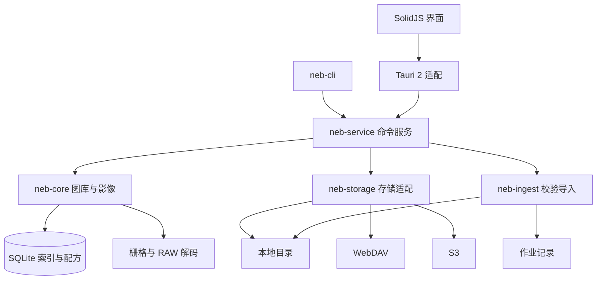

# 架构与数据设计

Nebulume 将文件、索引、存储和导入安全放在 Rust 中，SolidJS 负责交互。桌面应用和 CLI 使用同一命令服务，避免建立不同的业务路径。

## 组件

| 模块          | 职责                                                           |
| ------------- | -------------------------------------------------------------- |
| `neb-core`    | SQLite（`catalog.rs` 协调层 + `catalog/query.rs` 索引查询/统计 + `catalog/scan.rs` 批量本地扫描 + `catalog/xmp_sync.rs` 伴随同步）、非破坏 `.xmp` 合并解析（`xmp.rs`）、元数据、Canon CR3 解析（`cr3.rs`）、广色域 ICC 透传/AdobeRGB 合成与线性光色域变换（`icc.rs`）、macOS 原生 `ImageIO` 解码（`macos_imageio.rs`）、预览、直方图、裁剪、预设化导出与缓存管理 |
| `neb-storage` | 连接、凭据、作用域路径、目录列举、完整下载和版本锁定分段读取   |
| `neb-ingest`  | 冻结导入计划、伴随组同号重命名、子集勾选、双盘同步校验复制、协作取消与结果记录 |
| `neb-service` | 统一命令路由、任务编排、无锁导入进度跟踪、资源协调和错误语义   |
| `neb-app`     | Tauri 窗口、访达定位/外部软件交接/安全退卡（`shell.rs`）、文件对话框、主题及 IPC |
| `neb-cli`     | 命令行及可重复自动化入口                                       |
| `packages/ui` | 纯状态层（`tasks.ts`、`selection.ts`、`culling.ts`、`export-presets.ts` 等）、设计原语层（`src/ui/`）与薄视图层 |

核心模块不依赖 Tauri。前端不持有持久存储凭据，也不直接修改原片。

## 数据与身份

SQLite 保存图库、来源绑定、资产和编辑配方。图库绑定本地目录或远端来源前缀；一个存储源可提供多个图库。资产用稳定 ID 关联评级和裁剪，远端 `source_key` 保留原始键，与缓存路径分开。

schema 创建和迁移在同一个 IMMEDIATE 事务内检查版本，防止并发初始化产生重复或错误迁移。当前数据库结构版本为 v13：v13 为 FTS5 触发器增加 `WHEN` 列变更守卫（仅 `filename`/`path`/`metadata_json` 变化时重建全文索引，高频打星/打旗/裁剪零 FTS5 写放大），新增虚拟生成列 `exif_camera`、`exif_lens`、`exif_focal_mm`、`exif_iso` 及其复合索引（替代每次查询解析 JSON），新增 `catalog_revision.structural_value` 以便纯标记更新在不改变筛选/排序命中集时复用已缓存的有序 ID 列表，并将本地扫描拆分为锁外无 SQL 预检快照 + 每 250 项短事务批量提交。此前 v11/v12 引入 `trashed_at` 废纸篓记录与预览分支表汇合；v10 新增单行表 `catalog_revision`，由 `assets` 与 `libraries` 上的触发器在任何增删改（包括其他进程，如 CLI）时递增；`asset.list` 与 `asset.ids` 把同一筛选与排序下按配对折叠后的有序 ID 列表按修订计数缓存，翻页只读取当页行。此前 v9 新增 `assets.quick_hash`（文件首尾各 64 KiB 加文件大小的 SHA-256，小于 128 KiB 的文件取全文），只用于扫描时识别移动和改名，导入去重仍用完整 `sha256`；升级不读原件，旧资产在下次扫描遇到未变化的文件时补算。此前 v8 新增 `volume_identities`（卷身份，存储卡与外接库盘共用）、`cards`、`import_presets`、`import_batches`；此前 v7：v7 新增 `locations` 表（只存非秘密字段，id 与原存储源一致，凭据作用域不变）、`libraries.location_id` 与位置相对的 `assets.key`；直接选目录的本地库自动获得隐式位置，迁移只读 SQLite 内已有字段，旧 `root`/`storage_id` 列继续使用。此前 v5 增加独立拍摄时间索引及检查状态，v6 增加选图旗标 `flag`（none/pick/reject）及为导入批次与内容指纹预留的 `import_batch_id`、`sha256` 列；升级只从已有有效元数据迁移，不隐式访问远端。

文件创建、修改和 EXIF 拍摄时间分别保存。拍摄时间来自 DateTimeOriginal，按相机记录的日期、时间和子秒排序；保留已有时区但不推断缺失时区，不用文件或缓存时间补值。未知值在两个排序方向下均置后。

本地版本检测使用文件大小和修改标记，强一致操作使用 SHA-256。内容去重依据实际文件哈希，不能仅凭时间或大小。S3 ETag 不作为内容 SHA-256。

## 影像管线

1. 扩展名筛选候选，解码器确认内容。
2. 解析元数据、方向和可用拍摄时间。
3. 解码栅格或支持的 RAW；RAW 解码失败时可使用受限的 TIFF 内嵌 JPEG 回退，并明确报告预览来源。
4. 应用 EXIF 方向和归一化裁剪，生成有限尺寸的预览、缩略图或直方图。
5. 预览缓存按资产版本、尺寸和配方区分。仅补拍摄元数据不改变像素版本，避免重复解码。
6. JPEG 导出写入新文件，不覆盖源文件。RAW 导出要求传感器解码成功，不能使用内嵌预览代替。

预览分为五档：网格 `t256`/`t512`/`t1024`，查看器默认 `p2560`（最长边 2560px），查焦放大超过 `p2560` 时后台按需请求 `full`（最长边 9600px，不闪烁替换）。读取 RAW 时各档默认优先使用相机内嵌全尺寸 JPEG 以获得即时响应与相机直出影调；若内嵌预览远小于传感器分辨率则自动回退传感器显影，用户也可在查看器中按 `R` 手动切换 `prefer_raw` 传感器显影。

像素与元数据分路：`asset.preview` 经 IPC 只返回尺寸、来源、坐标映射和资产元数据；JPEG 字节由 `neb-app` 的 `neb` 自定义协议从 `Service::preview_image` 直接返回（路径支持可选 `/raw` 段区分传感器显影），以 ETag/304 复验，不再经 JSON 传 base64。CLI `neb preview` 走同一路径。

持久预览缓存键为 `preview-v3:`（资产、文件版本、尺寸、裁剪配方、档位与可选 `:raw` 模式）。v3 起预览与导出的 JPEG 内嵌源文件的 ICC 色彩配置（含栅格图、macOS `ImageIO` 解码的 `HEIC/HEIF/AVIF` Display P3，以及相机内嵌 JPEG 自带 ICC；若源文件/相机内嵌预览未带 ICC 但 EXIF 标注 `ColorSpace=2` / `InteropIndex=R03` 则合成标准 `Adobe RGB (1998)` ICC v2.1），由 WebView 做色彩管理，广色域照片不再偏色发灰；RAW 传感器显影仍按 sRGB 输出。旧 `preview-v1:`、`preview-v2:` 条目不转换，由常规回收淘汰。磁盘条目为二进制信封：`NPV2`、小端 `u32` 元数据长度、UTF-8 元数据 JSON、JPEG 字节；格式不符即报 `E_CACHE: Invalid preview cache`。Service 内另有本地/远端共享的内存 LRU，最多 256 项、128 MiB JPEG 字节，命中直接共享 `Arc<PreviewImage>`，不复制字节。

直方图基于渲染图；选片模式提供 2 张 / 4 张同步缩放与平移查焦台（`CompareStage`）及高光/暗部溢出警告叠加层（`ClippingOverlay`）。解码、容器和相机支持边界见[实施状态](STATUS.md)。

## 存储与凭据

本地路径经过 canonicalize 和来源根检查，拒绝路径穿越及越界符号链接。WebDAV 使用 PROPFIND/GET，S3 使用签名请求、自定义 endpoint 及 bucket/prefix。

公网连接使用标准 HTTPS。局域网可使用 HTTP，或经用户确认、按源固定 SHA-256 的设备证书。信任某个源不改变其他连接的校验；证书变化或过期会拒绝访问。

凭据默认保存在 Windows Credential Manager、macOS Keychain 或 Linux Secret Service，按配置和来源位置隔离，也支持显式会话凭据。启动时不连接远端，首次操作按需恢复凭据；凭据库不可用时明确报错，不降级为明文保存。配置、SQLite、日志及 UI 响应不包含秘密。

本地扫描结束时，本次未找到的旧资产标为 missing。若某个 missing 资产与本次扫描新索引的唯一一个文件大小和 `quick_hash` 都相同，视为移动或改名：保留原资产 id、评级、旗标、裁剪与导入批次，改指新路径，并删除新建的那条记录，同一事务完成。出现多个相同副本时无法判断，保持原状不合并；内容已变的文件按新照片处理。远端库不做此判断。

远端扫描只枚举并索引属性，不下载图片正文。列举受条目、目录和页数上限约束，不完整结果不标记资产丢失。当前同路径同大小的远端内容替换需显式重新读取原图。

## 按需读取与缓存

远端读取依次复用有效持久预览、当前原图缓存，再尝试受支持的 TIFF/RAW 内嵌预览分段读取；不满足条件时按自动/手动策略获取完整原图。分段请求绑定强 ETag 或 S3 versionId，严格检查范围、长度和版本，防止混用不同内容。

原图和预览共用容量预算，固定离线和正在使用的对象受保护。新内容写入前预约容量，校验完成后安全发布。普通原图可按未使用期限和容量回收，尽量保留小预览；不清理远端原件、图库记录、评级或配方。迁移通过复制校验、事务切换和恢复日志处理取消、崩溃与延迟清理。

拍摄时间补索引是显式后台任务，复用有效原图缓存或有界远端元数据读取；必要时读取单个 GET 响应的有限前缀，不为补索引新增完整原图缓存。任务停止保留完成项，失败项可重试。

具体缓存命令、传输预算和任务语义见[API](API.md)。

## 窗口与并发

管理界面分为图片库、存储源、存储卡和设置。独立查看窗口与管理窗口共享 Service，窗口上下文不放入 URL。单文件入口只索引指定文件，隐藏库不出现在管理列表；单实例适配接收后续文件请求。

Tauri 使用受控 CSP 和最小窗口权限。长任务在后台执行，前端按本地/远端、当前图/缩略图拆分调度，取消尚未发出的离屏请求。已开始的网络读取不即时中断。

网络访问和文件哈希不占全局目录锁。每库租约、每资产操作锁及缓存预约协调扫描、读取、重绑、导出、清理和迁移。远端扫描在网络期间释放目录锁，发布每页前复核绑定；同库扫描单独串行。

跨窗口事件按资产协调：评级或元数据更新不使无关预览失效，裁剪和原图刷新只更新对应资源；需要重算筛选或排序时保留已加载窗口、选择及滚动位置。

## 导入安全

导入按发现、计划、复制、校验和发布执行。计划冻结来源、目标、相对路径、大小和组织策略，执行时检查源是否变化。目标先写临时文件并同步，读回计算 SHA-256 后无覆盖发布。

内容冲突可跳过或按规则另存，不能覆盖不同内容。重试以实际目标内容为依据，不仅信任旧日志。RAW/JPEG/XMP 伴随组预检和失败停止不等于组级事务，成功成员保留。源文件始终不删除或修改。

来源可为任意挂载目录；目标当前限于具备安全硬链接发布能力的本地图库。完整行为和限制见[交互说明](INTERACTION.md)、[API](API.md)及[测试策略](TESTING.md)。
