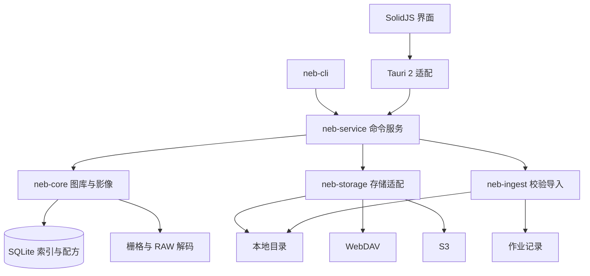

# 架构与数据设计

Nebulume 将文件、索引、存储和导入安全放在 Rust 中，SolidJS 负责交互。桌面应用和 CLI 使用同一命令服务，避免建立不同的业务路径。

## 组件

| 模块 | 职责 |
|---|---|
| `neb-core` | SQLite、扫描、查询、元数据、预览、直方图、裁剪、导出与缓存管理 |
| `neb-storage` | 连接、凭据、作用域路径、目录列举、完整下载和版本锁定分段读取 |
| `neb-ingest` | 冻结导入计划、内容哈希、校验复制、冲突处理和结果记录 |
| `neb-service` | 统一命令路由、任务编排、资源协调和错误语义 |
| `neb-app` | Tauri 窗口、系统路径、文件对话框、主题及 IPC |
| `neb-cli` | 命令行及可重复自动化入口 |
| `packages/ui` | 导航、图库、查看器、参数面板、导入和缓存交互 |

核心模块不依赖 Tauri。前端不持有持久存储凭据，也不直接修改原片。

## 数据与身份

SQLite 保存图库、来源绑定、资产和编辑配方。图库绑定本地目录或远端来源前缀；一个存储源可提供多个图库。资产用稳定 ID 关联评级和裁剪，远端 `source_key` 保留原始键，与缓存路径分开。

schema 创建和迁移在同一个 IMMEDIATE 事务内检查版本，防止并发初始化产生重复或错误迁移。当前数据库结构版本为 v5，增加独立拍摄时间索引及检查状态；升级只从已有有效元数据迁移，不隐式访问远端。

文件创建、修改和 EXIF 拍摄时间分别保存。拍摄时间来自 DateTimeOriginal，按相机记录的日期、时间和子秒排序；保留已有时区但不推断缺失时区，不用文件或缓存时间补值。未知值在两个排序方向下均置后。

本地版本检测使用文件大小和修改标记，强一致操作使用 SHA-256。内容去重依据实际文件哈希，不能仅凭时间或大小。S3 ETag 不作为内容 SHA-256。

## 影像管线

1. 扩展名筛选候选，解码器确认内容。
2. 解析元数据、方向和可用拍摄时间。
3. 解码栅格或支持的 RAW；RAW 解码失败时可使用受限的 TIFF 内嵌 JPEG 回退，并明确报告预览来源。
4. 应用 EXIF 方向和归一化裁剪，生成有限尺寸的预览、缩略图或直方图。
5. 预览缓存按资产版本、尺寸和配方区分。仅补拍摄元数据不改变像素版本，避免重复解码。
6. JPEG 导出写入新文件，不覆盖源文件。RAW 导出要求传感器解码成功，不能使用内嵌预览代替。

查看器请求最长边 2400px 的预览，直方图基于渲染图；当前没有完整分辨率瓦片或专业 ICC 工作流。解码、容器和相机支持边界见[实施状态](STATUS.md)。

## 存储与凭据

本地路径经过 canonicalize 和来源根检查，拒绝路径穿越及越界符号链接。WebDAV 使用 PROPFIND/GET，S3 使用签名请求、自定义 endpoint 及 bucket/prefix。

公网连接使用标准 HTTPS。局域网可使用 HTTP，或经用户确认、按源固定 SHA-256 的设备证书。信任某个源不改变其他连接的校验；证书变化或过期会拒绝访问。

凭据默认保存在 Windows Credential Manager、macOS Keychain 或 Linux Secret Service，按配置和来源位置隔离，也支持显式会话凭据。启动时不连接远端，首次操作按需恢复凭据；凭据库不可用时明确报错，不降级为明文保存。配置、SQLite、日志及 UI 响应不包含秘密。

远端扫描只枚举并索引属性，不下载图片正文。列举受条目、目录和页数上限约束，不完整结果不标记资产丢失。当前同路径同大小的远端内容替换需显式重新读取原图。

## 按需读取与缓存

远端读取依次复用有效持久预览、当前原图缓存，再尝试受支持的 TIFF/RAW 内嵌预览分段读取；不满足条件时按自动/手动策略获取完整原图。分段请求绑定强 ETag 或 S3 versionId，严格检查范围、长度和版本，防止混用不同内容。

原图和预览共用容量预算，固定离线和正在使用的对象受保护。新内容写入前预约容量，校验完成后安全发布。普通原图可按未使用期限和容量回收，尽量保留小预览；不清理远端原件、图库记录、评级或配方。迁移通过复制校验、事务切换和恢复日志处理取消、崩溃与延迟清理。

拍摄时间补索引是显式后台任务，复用有效原图缓存或有界远端元数据读取；必要时读取单个 GET 响应的有限前缀，不为补索引新增完整原图缓存。任务停止保留完成项，失败项可重试。

具体缓存命令、传输预算和任务语义见[API](API.md)。

## 窗口与并发

管理界面分为图片库、存储源、存储卡和设置。独立查看窗口与管理窗口共享 Service，窗口上下文不放入 URL。单文件入口只索引指定文件，隐藏库不出现在管理列表；单实例适配接收后续文件请求。

Tauri 使用受控 CSP 和最小窗口权限。长任务在后台执行，前端按本地/远端、当前图/缩略图拆分调度，取消尚未发出的离屏请求。已开始的网络读取不即时中断。

网络访问和文件哈希不占全局目录锁。每库租约、每资产操作锁及缓存预约协调扫描、读取、重绑、导出、清理和迁移。远端扫描在网络期间释放目录锁，发布每页前复核绑定；同库扫描单独串行。

跨窗口事件按资产协调：评级或元数据更新不使无关预览失效，裁剪和原图刷新只更新对应资源；需要重算筛选或排序时保留已加载窗口、选择及滚动位置。

## 导入安全

导入按发现、计划、复制、校验和发布执行。计划冻结来源、目标、相对路径、大小和组织策略，执行时检查源是否变化。目标先写临时文件并同步，读回计算 SHA-256 后无覆盖发布。

内容冲突可跳过或按规则另存，不能覆盖不同内容。重试以实际目标内容为依据，不仅信任旧日志。RAW/JPEG/XMP 伴随组预检和失败停止不等于组级事务，成功成员保留。源文件始终不删除或修改。

来源可为任意挂载目录；目标当前限于具备安全硬链接发布能力的本地图库。完整行为和限制见[交互说明](INTERACTION.md)、[API](API.md)及[测试策略](TESTING.md)。
