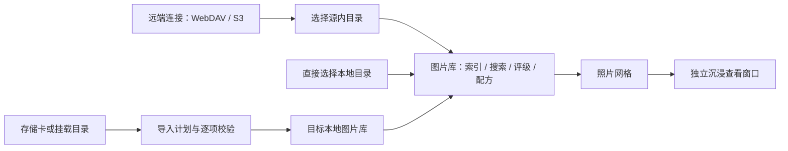

# 图片库与查看器交互

## 信息层级

图片库描述“要管理哪些影像”，创建时选择本地目录或远端连接。本地目录通过系统选择器直接建库，不需要先登记存储源；存储源管理仅显示WebDAV/S3远端连接，一个连接可以提供多个目录图片库。索引、评级、裁剪属于图片库，连接凭据和证书信任属于存储源。历史本地存储配置保留兼容，已有库无需重建。相册或精选是未来库内组织维度，不承担连接配置。

## 管理入口

| 入口   | 默认内容                                 | 后续操作                                                                |
| ------ | ---------------------------------------- | ----------------------------------------------------------------------- |
| 图片库 | 上次打开的图片库；侧栏列出全部库与文件夹 | 新建/编辑/移除库（侧栏“+”与每行“更多”）；组合筛选与排序；扫描；双击查看 |
| 存储源 | 已保存的远端连接和凭据状态               | 配置连接；实际测试；浏览目录；建库；移除无关联库的源                    |
| 存储卡 | OS卷枚举和手选挂载目录                   | 选择目标本地库；预览计划；确认导入；查看结果与历史                      |
| 设置   | 缓存策略、运行能力、主题与快捷键         | 管理缓存位置和容量；查看格式/平台边界；打开单个文件                     |

建立远端图片库后，扫描只索引目录属性；可见缩略图和打开的影像才按需读取内容。支持的经典TIFF/RAW优先分段获取内嵌预览，服务器/格式无法支持时按缓存策略完整获取。设置提供缓存位置、总配额、未使用天数及分类清理。管理页显示来源目录，文件详情区分远端键和本地缓存。导入完成自动更新目标库，结果可直接进入该库。

每窗口按本地/远端及缩略图/当前查看图分开调度，缩略图各4、查看图各2。切图、切库及离开预取范围会撤销尚未派发的旧请求，已加载缩略图离屏保留。已发出的Tauri IPC继续占用原通道直到完成，界面隔离迟到结果；这不代表可以中断服务端网络。远端扫描、连接验证和下载不占用本地图库的共享锁。

连接“已保存”和“已验证”分别显示。系统凭据库不可用时提供会话选项；升级前的内存凭据需首次重新输入。同一位置的设置修改保留已存秘密，地址、身份或TLS信任变化须重新验证。

图片库设置可修改名称、来源目录与RAW/JPEG合并展示。修改名称和展示偏好保留索引/评级/裁剪；改变来源目录前明确确认重建索引及丢弃旧库配方的后果，不移动文件。移除图片库的确认说明仅清除登记、索引、评级与配方，原图保留；移除存储源还会清除该源保存的凭据。有库引用的源不能直接移除，需先修改或移除关联库。

网格提供搜索、最低星级、文件格式（全部/RAW/JPEG）、排序字段及升降序。默认“拍摄时间”降序，来自相机DateTimeOriginal，按相机当地记录排序，不猜测缺失时区；已有时区仍在拍摄信息中保留。“文件创建时间”“文件修改时间”继续可选，避免与拍摄时间混淆。组合条件由整库查询处理后分页，不在已加载页内重排；拍摄/文件创建时间未知时，升降序均置后。文件创建时间来自源文件系统或WebDAV属性，旧本地库首次选择此排序补齐，旧远端库通过扫描更新补充。

选择拍摄排序不自动读取整库原件。v5升级仅利用已有元数据；远端未读过拍摄信息的照片仍为“待索引”。拍摄排序旁按需显示“索引拍摄时间”，须用户明确启动；运行后原位显示已处理/本次总数和停止按钮，每秒更新，不禁用浏览、评级或导航。悬停区分“已知”“未获得”“待索引”；“未获得”包含未记录、记录无效及格式暂不支持，读取失败仍待索引并可重试。完成、失败或停止后只统一更新已加载查询，保留选中项与滚动，不重新解码已加载图片；详情沿用原有拍摄时间位置，不增加重复文字。

索引只读JPEG/经典TIFF EXIF及采用此结构的部分RAW的拍摄字段，不解码像素、不增加原图缓存；远端优先Range，必要时仅读取同一个GET的有限前缀，具体边界见[API契约](API.md#拍摄时间后台索引)。切页任务继续，返回读取真实状态；停止是协作式的，显示“正在停止”直到当前项结束，保留已读取结果，再次开始只处理剩余待索引项。任务状态不跨应用重启恢复，已写入的索引保留。

每个库独立保存RAW/JPEG合并选项，默认关闭。启用后同目录同名的一对RAW/JPEG显示为一个卡片，保留两个文件入口；默认以符合筛选的JPEG展示，仅看RAW时以RAW展示。多份同类文件有歧义则保持分开，评级和配方不在两份文件间自动同步。

管理窗口重新获得焦点不会重新请求列表、详情或图片。查看器的真实评级、裁剪和原图刷新会定向同步对应影像；评级本身不使图片缓存失效，裁剪或原图刷新只更新受影响的图片资源。变更影响当前筛选成员、RAW/JPEG代表项或排序位置时，再在后台向整库查询核对，保留已加载范围、滚动位置与仍有效的选择/详情，不先清空网格。同步失败会显示可重试提示；重新获得焦点只重试已知失败的变更或监听连接，不把窗口切换视为内容变化。

## 导航与配置归属

所有页面使用同一套设计系统（[设计规范](superpowers/specs/2026-11-10-design-system-design.md)，组件参考在开发版 `?design=1`）：56px 页头放标题、视图切换或步骤条、至多一个主操作与“更多”，下面是可选的工具栏，内容为单栏或主栏加 300px 侧栏。图标栏自上而下为“图片库 / 导入 / 位置”，底部是“打开文件…”与“设置”；`⌘K`（Windows/Linux `Ctrl+K`）可在任意页面唤起全局命令面板，快速跳转图片库、精选集、文件夹、筛选条件或设置分组。“位置”管理本地、外接盘重定位与网络位置的连接、凭据、证书信任和测试；“导入”包含存储卡登记与绑定、导入方案和导入历史。每项配置只有一个归属：连接相关属于位置，索引与配对属于图片库，“怎么导”属于导入方案，“这张卡默认用哪个方案”属于存储卡。设置页收敛为“外观与浏览 / 缓存与离线 / 快捷键 / 关于”四个单栏分组（记在地址 hash 中）：外观主题与浏览选片开关、单栏结构化缓存配额与维护、快捷键参考表格，以及产品化的版本更新、打开数据目录与复制诊断摘要。“打开文件…”在图标栏底部，不属于设置。

在导入页点选可移动卷时，应用只读识别卷根 `.nebulume/volume.json`。已登记的卡显示名称、上次导入时间，并自动套用其默认导入方案。未登记的卡可“登记这张卡”：写入并读回这个很小的识别文件，照片不被改动；写保护卡会如实报错。格式化后的卡丢失识别文件，若卷标、序列号或容量与已登记的卡相符，会提示“可能匹配”，由用户选择“绑定到此记录”，绝不自动绑定。也可以不登记直接导入。

导入方案保存目标图片库、目录整理规则与去重选项；“保存当前设置为方案”同名即覆盖，可“设为这张卡的默认方案”。导入完成后记录导入批次，只标记本次实际复制的照片；结果页提供“开始选图（N 张）”，直接把图片库筛选到该批次并以选图模式打开。图片库工具栏的“导入批次”下拉可随时回到某次导入。

## 导入到 NAS

导入目标可以是本地图片库，也可以是 WebDAV / S3 图片库。向网络位置导入前须在“位置”点“测试写入”：应用写入并删除一个测试文件，确认能新建且不会覆盖已有内容；通过后显示“可导入”，不支持的服务器显示“不可导入”。结果只在本次运行中有效。未通过时计划页说明原因并提供“前往位置”，“开始导入”保持禁用。

规划不下载 NAS 上的文件：有内容指纹的按内容严格判重；无指纹但文件名、大小、拍摄日都相同的标为“疑似重复”，默认跳过，勾选“仍然导入疑似重复项”才上传。每个文件经校验后才出现在目标位置，已有文件不会被覆盖；完成后照片直接进入目标库与本次导入批次，可立即选图。卡上原片始终保留。

## 内容指纹

“图片库设置”中的“内容指纹”显示已建立 / 总数与待处理大小。点“建立内容指纹”在后台计算 SHA-256，可随时停止，已完成的结果保留；网络图片库会先说明需要完整下载的文件数与大小，确认后才开始，下载内容不进入缓存。建立后，导入到该库时按内容严格判重，原先的“疑似重复”变为准确的“已在库中”。照片被修改后指纹自动失效，需要时再建立。

## 导入目录整理

导入表单的“目录整理”提供固定选项：分类依据（按拍摄日期 / 按导入日期 / 保留卡内目录 / 不分日期）、日期层级（`2026-10-22`、`2026/2026-10-22`、`2026/10/2026-10-22`、`2026/10/22`）、可选子目录（如 `Camera/Z8`）、按类型分目录（RAW / JPG / TIFF / OTHER，XMP 跟随 RAW），以及导入重命名规则（保留相机原文件名 / 拍摄日期+前缀+四位序号 / 自定义前缀+原文件名，同组 RAW+JPEG+XMP 自动保持同号主文件名）与可选“双盘同时备份到副盘”。核对步骤支持按单文件或按拍摄日勾选导入子集，导入期间实时显示字节与张数确定进度并支持在伴随组边界安全取消，完成后支持一键安全推出可移动存储卡。无拍摄时间的文件默认归入 `unknown-date`；只有勾选“改用文件修改日期”才按修改日归档，计划表逐项标注“文件修改时间”。

侧栏在当前激活的图片库行下方以从属导轨展开“精选集”（手动精选集与按规则实时聚合的智能精选集）与“文件夹”下级目录树（不再重复显示图片库本级根目录节点，并自动过滤 `.photoslibrary` / `.lrdata` 等封装包内部目录，整库范围由图片库行本身承载）。

点图标栏的“图片库”打开上次打开的库（没有记录时打开第一个）。侧栏底部固定的“全部图片库”打开所有库的卡片总览：三联画封面、张数、来源、位置（含外接卷标）、在线状态与最近拍摄，可从这里新建图片库，每张卡片的“更多”与侧栏相同；点卡片进入该库。外接移动硬盘离线时仍可浏览缓存缩略图、修改标记与整理精选集，挂载点变更后支持一键无损重定位（`library.relocate`）。一个库都没有时显示“还没有图片库”与“新建图片库”“从存储卡导入”。侧栏每个库的行尾用圆点表示位置状态（悬停显示文字）：在线、未连接（本次启动尚未访问）、未挂载/不可达、需要登录、证书待确认、访问出错；行的“更多”提供图片库设置、扫描更新、预生成缩略图、补全拍摄时间、内容指纹与移除登记。不可用的库仍可进入：已有索引、星级、旗标、搜索、筛选和排序照常可用，有缓存或固定离线的照片照常查看。进入后顶部提示原因，并提供直达连接设置的“检查连接 / 重新登录 / 检查证书”及“重试”。不可用时页头与侧栏菜单中的“扫描更新”禁用并在悬停中说明原因，不把未能枚举的照片当作丢失。状态只来自实际操作结果，不做后台心跳。

## 网格选择与键盘

图片库侧栏支持一键收起与展开（顶栏按钮或 `Ctrl/⌘+B`），收起状态持久化在本机，页头左侧提供展开按钮。长耗时任务（图库扫描、批量导出、缩略图预生成）统一汇总在页头右侧非阻塞“后台任务”胶囊中显示进度与结果，不锁定网格浏览、打标或进入选片。

网格是一个 Tab 停靠点（roving tabindex）：只有当前焦点照片可被 Tab 聚焦。方向键按格与按行移动（列数取自实时布局，随缩略图尺寸变化），`Home` / `End` 到首尾，`PageUp` / `PageDown` 翻一屏；按住 `Shift` 移动会扩展选择。点击单选；`Shift` 点击选择范围，`Ctrl/⌘` 点击增减，`Ctrl/⌘+A` 通过 `asset.ids` 选中当前筛选条件下的全部照片（包含尚未滚动载入的页），`Space` 快速打开/关闭当前照片查看预览，`Esc` 退回单张。焦点照片始终计入选择，详情与查看器跟随焦点照片。

选中多于一张时在工作区底部浮出毛玻璃批量操作坞（不挤占或推动照片网格布局），提供 0–5 星、留用/淘汰/清除旗标、红/黄/绿/蓝色标、加入/移出精选集、导出与移到废纸篓；`1`–`5` / `0`、`P` / `X` / `U` 与 `6`–`9`（红/黄/绿/蓝色标，再次按下同色标清除）作用于整个选择（含 `⌘A` 选中的未载入照片），均支持 `⌘Z` 撤销。工具栏在拍摄时间排序下支持一键“折叠连拍”（自动聚合相邻 ≤ 2 秒同机身连拍组，网格角标可单独展开/收起），右侧提供按年/月快速定位的日期滑尺（`DateScrubber`）。影像详情（`I`）支持编辑 `>` 分级的层级关键词（如 `人像 > 客片`），筛选父词自动包含全部子词，并与色标一同双向无损同步 `.xmp`（`xmp:Label`、`dc:subject`、`lr:hierarchicalSubject`）。多张标记经 `asset.mark_batch` 每 1000 张一个事务写入。

批量操作条与照片菜单同时提供一键“导出 JPEG…”与“按预设导出…”（`⌘⇧E`）：一键导出沿用默认母版配方直接渲染为 `<原文件名>-edited.jpg`；“按预设导出…”打开导出面板（内置原尺寸母版、客户审片 4K、社媒与网页 2K、商业印刷 Adobe RGB、广色域展示 Display P3 五组预设并支持保存自定义预设，可配置长边像素上限、30–100% 品质、线性光色域转换与 ICC 嵌入、以及原名/编辑后缀/拍摄日+原名/前缀+四位序号模板并实时预览输出文件名）。同名文件已存在时依次改用 `-2`、`-3`，从不覆盖。

本地照片菜单与查看器“更多”还提供“在文件夹中显示”、“用默认应用打开”、“选择外部精修软件打开…”（启动外部软件前自动将最新星级、旗标与裁剪无损同步到同名 `.xmp` 伴随文件，保留已有 Lightroom/Camera Raw 参数），以及手动“写入 .xmp 伴随文件”与“从 .xmp 重新读取标记”；图库菜单支持整库 `.xmp` 导出与外部修改回读，“设置 → 外观与浏览”提供打标/裁剪时自动同步 `.xmp` 开关。

右键、`Shift+F10` 或菜单键打开照片菜单：在查看器中打开、在新窗口中打开（桌面版）、从此照片开始选图、评级、旗标、显示详情、导出为 JPEG、移到废纸篓（本地图片库）、复制文件路径、重新读取原图（桌面版）。

`⌘⌫`（Windows / Linux 为 `Ctrl+Delete`）或菜单“移到废纸篓”把所选照片移到系统废纸篓，RAW 与同目录同名 JPEG 一起移动；选择移到下一张，提示条上的“撤销”在 10 秒内把文件放回原处。图库记录保留 30 天，在访达中“放回原处”后重新扫描也会恢复评级与旗标。网络存储上的照片不能移到废纸篓。在已选范围内打开时作用于整个选择，否则只作用于该照片。菜单内方向键移动，`Esc` / `Tab` 关闭并把焦点还给照片。

把文件夹拖到主窗口会打开“新建图片库”，并预填该目录与名称；该目录已是图片库时直接进入。拖入影像文件则像“打开文件…”一样在查看器中打开（一次最多 100 个）；其他文件不处理并给出提示。拖动过程中显示覆盖提示。查看窗口不接收拖放。

工具栏在库内有 EXIF 记录时显示“机身”“镜头”筛选，选项来自该库实际出现的值并附数量；“拍摄日期”按相机当地日期筛选含端点的范围，没有拍摄时间的照片不显示。这些筛选与搜索、评级、旗标、格式组合，“清除筛选”一并重置，切换图片库时清空。

网格接近底部时自动载入下一页；某页载入失败后停止自动载入，改用“载入更多”重试，避免滚动时反复报错。载入中显示骨架格。完成提示 6 秒后自动关闭，错误与同步失败保持到关闭或重试。图库的设置与移除收在“更多操作”菜单中，“扫描更新”为主操作。

图库顶栏在“照片 / 选片 / 概览”三个视图间切换（`⌘1` / `⌘2` / `⌘3`）。三者都限定在侧栏选中的图片库或文件夹，以及当前筛选。

概览统计的正是网格会显示的那些照片：照片数、留用率、原片占用与未处理数，按跨度自适应按日 / 按周 / 按月聚合的交互式拍摄时间线，选片漏斗进度（留用 / 淘汰 / 评了星 / 未处理），相机与镜头卡片排行，焦距与 ISO 分布。每根柱子、每段、每行都可点击：切回“照片”并加上对应的可移除筛选标签。

选片在主窗口内进行。点“选片”或按 `Shift+C`，以当前搜索、评级、旗标、格式与排序的整库结果进入，起点为选中照片；查看器中 `Shift+C` 也可切入或切回。右侧面板显示已看进度、留用与淘汰计数、直方图（看过的照片从服务端缓存读取）、曝光与相机，以及留用 / 淘汰按钮和星级；底部胶片条用绿线或红线标出旗标，看过的照片更亮。

窗口打开时一次性快照队列（最多 10000 张），之后的标记不改变成员：即使按“未标记”进入，打标后的照片也不会消失或导致跳号；关闭窗口后网格再按筛选核对。

| 键              | 选图模式                                                      |
| --------------- | ------------------------------------------------------------- |
| `1`–`5` / `0`   | 打星 / 清除星级                                               |
| `P` / `X` / `U` | 留用 / 淘汰 / 清除旗标                                        |
| `←` `→`         | 上一张 / 下一张                                               |
| `G` / `C`       | 单张 / 对比视图（支持 2 张 / 4 张同步缩放查焦，焦点窗格接收标记） |
| `Z`             | 适合窗口 ↔ 原图 1:1 像素（按需无缝升级 `full` 高清预览）       |
| `J`             | 高光（红）/ 暗部（蓝）溢出斑马纹警告                          |
| `R`             | RAW 相机内嵌预览 ↔ RAW 传感器显影切换                         |
| `Ctrl/⌘+Z`      | 撤销上一次标记并回到该照片                                    |
| `Tab`           | 隐藏或显示选图信息                                            |
| `Shift+F`       | 相机对焦区域（普通查看与选图模式统一）                        |
| `Space` / `Esc` | 快速关闭预览，或退出全屏后关闭窗口                            |
| `F`             | 切换全屏                                                      |

“完成选片”分两栏：留用的照片按裁剪导出为 JPEG；淘汰的照片显示文件数与占用，确认后移到系统废纸篓，可撤销。不点确认，原片不受影响。

选图模式不提供裁剪，`C` 用于对比视图；需裁剪时切回普通模式。打星或打旗后底部信息条做约 250ms 确认动效，淘汰的照片画面变暗；减少动效偏好下改为无位移高亮。“自动下一张”默认开启，动效结束即前进，到最后一张停住并提示，不循环；工具栏即时切换，“设置 → 浏览与选图”保存默认值。动效期间再次按键会立即结束当前确认并作用于下一张，不丢键。

标记先在界面生效再写目录；写入失败会恢复原值、提示错误并回到该照片，不前进。旗标与评级一样只保存在目录中，不修改原片，不使预览缓存失效，并经跨窗口事件同步到管理网格。网格提供“所有旗标 / 留用 / 未标记 / 淘汰 / 隐藏淘汰”筛选，缩略图标注留用或淘汰。

## 查看窗口

在图片库中双击或 Enter 在主窗口内打开查看器，照片从缩略图原位放大，Esc 缩回原位并回到最后看的那张；照片菜单“在新窗口中打开”使用独立窗口。查看器不显示图片库、连接或导入导航。黑底画布优先显示图片，工具栏在静止约 2 秒后收起；支持左右切图、滚轮与触控板捏合以光标为中心缩放、双击或 Z 在适合窗口与 100% 间切换、拖动平移及全屏。`⌘⌫` 把当前照片移到废纸篓并前进到下一张，可撤销。

从访达、文件关联、拖入或“打开文件…”打开单张照片时，独立窗口浏览它所在文件夹的其他影像：文件名来自目录列表，只在看到某张时才索引那一张（下一张在后台准备），不扫描整个文件夹。照片铺满窗口，标题栏显示文件夹名。文件夹不在任何图片库中时提示“评级和旗标只保存在本机”，“加入图片库”把该文件夹建为图片库并扫描。顶栏只放返回、文件名、“查看 / 选片”、叠加信息（D）、对焦点、信息（I）、裁剪（C）与“更多”；“更多”提供导出、重新读取原图、全屏、复制路径、在图片库中显示、加入图片库、编辑叠加信息和移到废纸篓。

画面四角各是一摞叠加信息小部件（拍摄时间、星级、旗标、曝光组合、光圈、快门、ISO、焦距、曝光补偿、测光、白平衡、相机、镜头、直方图、尺寸、文件大小、格式、GPS、文件名、序号、文件夹），默认左上拍摄时间，右上星级与旗标，左下相机镜头与曝光，右下直方图。缺少数据的部件不显示。D 显示或隐藏；默认不随工具栏淡出（可在设置中改）。“更多 → 编辑叠加信息…”让照片变暗：从底部托盘拖部件到任意角，或在角之间拖动；键盘上每个部件按 Enter 有“上移 / 下移 / 移到其他角 / 移除”，每个角有“+ 添加”，托盘里有“恢复默认”。布局记在本机，所有查看器共用；读不出的布局回到默认。

I展开信息、直方图与EXIF；C进入裁剪，支持“自由 / 原图 / 3:2 / 4:3 / 16:9 / 4:5 / 1:1”画幅比例约束与“横竖 ↔”方向一键互换，保存配方后刷新预览；编辑期间阻止切图，避免迟到响应应用到其他照片。普通查看与选片模式均支持 `Z` 切换原图 1:1 查焦、`J` 切换高光/暗部溢出警告叠加层、`R` 在 RAW 相机内嵌预览与传感器显影间切换。

普通查看模式下同样支持 `P` / `X` / `U` 直接标记留用、淘汰、清除旗标（含 `Ctrl/⌘+Z` 撤销），以及 `Space` 快速关闭预览返回网格。工具栏对焦区域图标或 `Shift+F` 切换对焦区域，默认关闭；按钮省去常驻“对焦点”文字，保留悬停名称与可访问名称。浏览到当前图片时自动检测相机记录；检测中、无记录、未支持或无法可靠显示时按钮置灰，悬停说明原因，画布不显示对焦状态条。显示偏好跨图保留，回到可用照片时恢复之前的选择。当前解析范围是Nikon AFInfo2的精确版本0300/0301；不绘制假定的中心点。显示的是拍摄时记录的区域，不代表软件重新计算出的焦点。

对焦坐标以方向修正后的全图为基准，不再次旋转。覆盖层先核对预览的方向与全图纵横比，再使用渲染器实际裁剪范围映射，随图片缩放和平移；缺少可靠映射、方向不符或画幅比例差异超过1%时暂停绘制，原因归入按钮提示。落在裁剪外的区域不显示。裁剪编辑期间暂隐藏，退出后恢复；切图或重新读取原图使旧请求失效，开关/评级不重复读取对焦记录。覆盖层不拦截图片操作，也不修改原图。

信息栏把直方图与曝光三要素放在同一阅读区域：图下固定显示光圈、快门、ISO，缺少数据用空值标识。“拍摄信息”先列用户固定的字段（默认焦距、镜头、相机、拍摄时间、尺寸，缺少时显示“—”），可聚焦后用 Alt+↑/↓ 排序、Enter 取消固定；随后每个已记录字段出现一次，点图钉固定。固定的字段与顺序记在本机，图片库详情与查看器共用。全部原始 EXIF 和解码诊断仍按需展开。

“重新读取原图”可检查远端同尺寸更新，成功下载后才切换缓存版本。关闭查看窗口返回原有管理上下文；单独通过文件路径启动时可只显示查看器。后续文件打开请求由同一进程接收，安装包登记受支持格式的文件关联候选，不修改系统默认应用。

## 当前边界

查看器在适合窗口下使用 `p2560`，放大超过 `p2560` 分辨率时后台无缝升级至 `full`（最长边 9600px）；超高像素画幅的金字塔瓦片、软打样与自定义相机 DCP 色彩矩阵仍属后续演进。Canon `.cr3` 在全平台支持相机内嵌预览与元数据读取（暂不支持传感器显影与 RAW 全尺寸导出）；`HEIC/HEIF/AVIF` 在 macOS 通过原生 `ImageIO` 支持索引、广色域 ICC 预览与导出。OS卷类型不能证明是SD卡，手选目录一直可用。当前SD导入支持本地图库及经显式写入校验的 WebDAV/S3 图库；导入取消/续传和安全弹出尚未实现。

远端按需预览、缓存回收和迁移的命令及边界见[API契约](API.md)。
