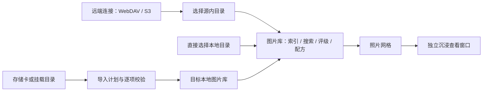

# 图片库与查看器交互

## 信息层级

图片库描述“要管理哪些影像”，创建时选择本地目录或远端连接。本地目录通过系统选择器直接建库，不需要先登记存储源；存储源管理仅显示WebDAV/S3远端连接，一个连接可以提供多个目录图片库。索引、评级、裁剪属于图片库，连接凭据和证书信任属于存储源。历史本地存储配置保留兼容，已有库无需重建。相册或精选是未来库内组织维度，不承担连接配置。

## 管理入口

| 入口 | 默认内容 | 后续操作 |
|---|---|---|
| 图片库 | 库列表、来源与可访问状态 | 新建/编辑/移除库；进入网格；组合筛选与排序；扫描；双击查看 |
| 存储源 | 已保存的远端连接和凭据状态 | 配置连接；实际测试；浏览目录；建库；移除无关联库的源 |
| 存储卡 | OS卷枚举和手选挂载目录 | 选择目标本地库；预览计划；确认导入；查看结果与历史 |
| 设置 | 缓存策略、运行能力、主题与快捷键 | 管理缓存位置和容量；查看格式/平台边界；打开单个文件 |

建立远端图片库后，扫描只索引目录属性；可见缩略图和打开的影像才按需读取内容。支持的经典TIFF/RAW优先分段获取内嵌预览，服务器/格式无法支持时按缓存策略完整获取。设置提供缓存位置、总配额、未使用天数及分类清理。管理页显示来源目录，文件详情区分远端键和本地缓存。导入完成自动更新目标库，结果可直接进入该库。

每窗口按本地/远端及缩略图/当前查看图分开调度，缩略图各4、查看图各2。切图、切库及离开预取范围会撤销尚未派发的旧请求，已加载缩略图离屏保留。已发出的Tauri IPC继续占用原通道直到完成，界面隔离迟到结果；这不代表可以中断服务端网络。远端扫描、连接验证和下载不占用本地图库的共享锁。

连接“已保存”和“已验证”分别显示。系统凭据库不可用时提供会话选项；升级前的内存凭据需首次重新输入。同一位置的设置修改保留已存秘密，地址、身份或TLS信任变化须重新验证。

图片库设置可修改名称、来源目录与RAW/JPEG合并展示。修改名称和展示偏好保留索引/评级/裁剪；改变来源目录前明确确认重建索引及丢弃旧库配方的后果，不移动文件。移除图片库的确认说明仅清除登记、索引、评级与配方，原图保留；移除存储源还会清除该源保存的凭据。有库引用的源不能直接移除，需先修改或移除关联库。

网格提供搜索、最低星级、文件格式（全部/RAW/JPEG）、排序字段及升降序。默认“拍摄时间”降序，来自相机DateTimeOriginal，按相机当地记录排序，不猜测缺失时区；已有时区仍在拍摄信息中保留。“文件创建时间”“文件修改时间”继续可选，避免与拍摄时间混淆。组合条件由整库查询处理后分页，不在已加载页内重排；拍摄/文件创建时间未知时，升降序均置后。文件创建时间来自源文件系统或WebDAV属性，旧本地库首次选择此排序补齐，旧远端库通过扫描更新补充。

选择拍摄排序不自动读取整库原件。v5升级仅利用已有元数据；远端未读过拍摄信息的照片仍为“待索引”。拍摄排序旁按需显示“索引拍摄时间”，须用户明确启动；运行后原位显示已处理/本次总数和停止按钮，每秒更新，不禁用浏览、评级或导航。悬停区分“已知”“未获得”“待索引”；“未获得”包含未记录、记录无效及格式暂不支持，读取失败仍待索引并可重试。完成、失败或停止后只统一更新已加载查询，保留选中项与滚动，不重新解码已加载图片；详情沿用原有拍摄时间位置，不增加重复文字。

索引只读JPEG/经典TIFF EXIF及采用此结构的部分RAW的拍摄字段，不解码像素、不增加原图缓存；远端优先Range，必要时仅读取同一个GET的有限前缀，具体边界见[API契约](API.md#拍摄时间后台索引)。切页任务继续，返回读取真实状态；停止是协作式的，显示“正在停止”直到当前项结束，保留已读取结果，再次开始只处理剩余待索引项。任务状态不跨应用重启恢复，已写入的索引保留。

每个库独立保存RAW/JPEG合并选项，默认关闭。启用后同目录同名的一对RAW/JPEG显示为一个卡片，保留两个文件入口；默认以符合筛选的JPEG展示，仅看RAW时以RAW展示。多份同类文件有歧义则保持分开，评级和配方不在两份文件间自动同步。

管理窗口重新获得焦点不会重新请求列表、详情或图片。查看器的真实评级、裁剪和原图刷新会定向同步对应影像；评级本身不使图片缓存失效，裁剪或原图刷新只更新受影响的图片资源。变更影响当前筛选成员、RAW/JPEG代表项或排序位置时，再在后台向整库查询核对，保留已加载范围、滚动位置与仍有效的选择/详情，不先清空网格。同步失败会显示可重试提示；重新获得焦点只重试已知失败的变更或监听连接，不把窗口切换视为内容变化。

## 导航与配置归属

主导航为“图片库 / 位置 / 导入 / 设置”。“位置”管理本地与网络位置的连接、凭据、证书信任和测试；“导入”包含存储卡登记与绑定、导入方案和导入历史。每项配置只有一个归属：连接相关属于位置，索引与配对属于图片库，“怎么导”属于导入方案，“这张卡默认用哪个方案”属于存储卡。设置页只保留应用级偏好与本机资源：外观、浏览与选图、缓存、快捷键参考（按网格 / 查看窗口 / 选图模式分组）、只读的关于与诊断，并列出其他配置所在页面及直达入口。“打开文件…”位于顶栏，不属于设置。

在导入页点选可移动卷时，应用只读识别卷根 `.nebulume/volume.json`。已登记的卡显示名称、上次导入时间，并自动套用其默认导入方案。未登记的卡可“登记这张卡”：写入并读回这个很小的识别文件，照片不被改动；写保护卡会如实报错。格式化后的卡丢失识别文件，若卷标、序列号或容量与已登记的卡相符，会提示“可能匹配”，由用户选择“绑定到此记录”，绝不自动绑定。也可以不登记直接导入。

导入方案保存目标图片库、目录整理规则与去重选项；“保存当前设置为方案”同名即覆盖，可“设为这张卡的默认方案”。导入完成后记录导入批次，只标记本次实际复制的照片；结果页提供“开始选图（N 张）”，直接把图片库筛选到该批次并以选图模式打开。图片库工具栏的“导入批次”下拉可随时回到某次导入。

## 导入目录整理

导入表单的“目录整理”提供固定选项：分类依据（按拍摄日期 / 按导入日期 / 保留卡内目录 / 不分日期）、日期层级（`2026-10-22`、`2026/2026-10-22`、`2026/10/2026-10-22`、`2026/10/22`）、可选子目录（如 `Camera/Z8`）和按类型分目录（RAW / JPG / TIFF / OTHER，XMP 跟随 RAW）。表单实时显示示例路径，选项按本机记住。无拍摄时间的文件默认归入 `unknown-date`；只有勾选“改用文件修改日期”才按修改日归档，计划表逐项标注“文件修改时间”。文件名不改变，重复与冲突规则不变。

图片库卡片右上角显示位置状态：在线、未连接（本次启动尚未访问）、未挂载/不可达、需要登录、证书待确认、访问出错。不可用的库卡片置灰但仍可进入：已有索引、星级、旗标、搜索、筛选和排序照常可用，有缓存或固定离线的照片照常查看。进入后顶部提示原因，并提供直达连接设置的“检查连接 / 重新登录 / 检查证书”及“重试”。不可用时“扫描更新”禁用并说明原因，不把未能枚举的照片当作丢失。状态只来自实际操作结果，不做后台心跳。

选图是查看窗口的一种模式，不是独立工作区。图库网格点“选图”或按 `Shift+C`，以当前搜索、评级、旗标、格式与排序的整库结果打开查看窗口并直接进入选图模式，起点为选中照片；普通查看时 `Shift+C` 也可切入或切回。工具栏的“查看 / 选图”显示当前模式，切换不改变当前照片与缩放。

窗口打开时一次性快照队列（最多 10000 张），之后的标记不改变成员：即使按“未标记”进入，打标后的照片也不会消失或导致跳号；关闭窗口后网格再按筛选核对。

| 键 | 选图模式 |
|---|---|
| `1`–`5` / `0` | 打星 / 清除星级 |
| `P` / `X` / `U` | 留用 / 淘汰 / 清除旗标 |
| `←` `→` | 上一张 / 下一张 |
| `G` / `C` | 单张 / 对比视图（2 张并排，焦点项接受标记） |
| `Z` | 适合窗口 ↔ 预览像素 1:1 |
| `Ctrl/⌘+Z` | 撤销上一次标记并回到该照片 |
| `Tab` | 隐藏或显示选图信息 |
| `Shift+F` | 相机对焦区域（普通模式仍为 `P`） |
| `F` / `Esc` | 全屏 / 退出全屏，否则关闭窗口 |

选图模式不提供裁剪，`C` 用于对比视图；需裁剪时切回普通模式。打星或打旗后底部信息条做约 250ms 确认动效，淘汰的照片画面变暗；减少动效偏好下改为无位移高亮。“自动下一张”默认开启，动效结束即前进，到最后一张停住并提示，不循环；工具栏即时切换，“设置 → 浏览与选图”保存默认值。动效期间再次按键会立即结束当前确认并作用于下一张，不丢键。

标记先在界面生效再写目录；写入失败会恢复原值、提示错误并回到该照片，不前进。旗标与评级一样只保存在目录中，不修改原片，不使预览缓存失效，并经跨窗口事件同步到管理网格。网格提供“所有旗标 / 留用 / 未标记 / 淘汰 / 隐藏淘汰”筛选，缩略图标注留用或淘汰。

## 查看窗口

双击或Enter打开专用窗口；浏览器验证模式使用独立覆盖层。查看器不显示图片库、连接或导入导航。黑底画布优先显示图片，工具栏在静止时收起；支持左右切图、滚轮缩放、拖动平移、适合窗口、预览像素1:1及全屏。I展开信息、直方图与EXIF；C进入裁剪，保存配方后刷新预览；编辑期间阻止切图，避免迟到响应应用到其他照片。

工具栏对焦区域图标或P切换对焦区域，默认关闭；按钮省去常驻“对焦点”文字，保留悬停名称与可访问名称。浏览到当前图片时自动检测相机记录；检测中、无记录、未支持或无法可靠显示时按钮置灰，悬停说明原因，画布不显示对焦状态条。显示偏好跨图保留，回到可用照片时恢复之前的选择。当前解析范围是Nikon AFInfo2的精确版本0300/0301；不绘制假定的中心点。显示的是拍摄时记录的区域，不代表软件重新计算出的焦点。

对焦坐标以方向修正后的全图为基准，不再次旋转。覆盖层先核对预览的方向与全图纵横比，再使用渲染器实际裁剪范围映射，随图片缩放和平移；缺少可靠映射、方向不符或画幅比例差异超过1%时暂停绘制，原因归入按钮提示。落在裁剪外的区域不显示。裁剪编辑期间暂隐藏，退出后恢复；切图或重新读取原图使旧请求失效，开关/评级不重复读取对焦记录。覆盖层不拦截图片操作，也不修改原图。

信息栏把直方图与曝光三要素放在同一阅读区域：图下固定显示光圈、快门、ISO，缺少数据用空值标识；随后展示设备及其他拍摄参数，全部有效EXIF和解码诊断按需展开，避免重复挤占首屏。

“重新读取原图”可检查远端同尺寸更新，成功下载后才切换缓存版本。关闭查看窗口返回原有管理上下文；单独通过文件路径启动时可只显示查看器。后续文件打开请求由同一进程接收，安装包登记受支持格式的文件关联候选，不修改系统默认应用。

## 当前边界

查看器使用有界预览，1:1指预览像素；完整分辨率瓦片、专业ICC与相机矩阵样本仍属后续验收。OS卷类型不能证明是SD卡，手选目录一直可用。当前SD导入仅写本地图片库；远端写入、导入取消/续传和安全弹出尚未实现。

远端按需预览、缓存回收和迁移的命令及边界见[API契约](API.md)。
