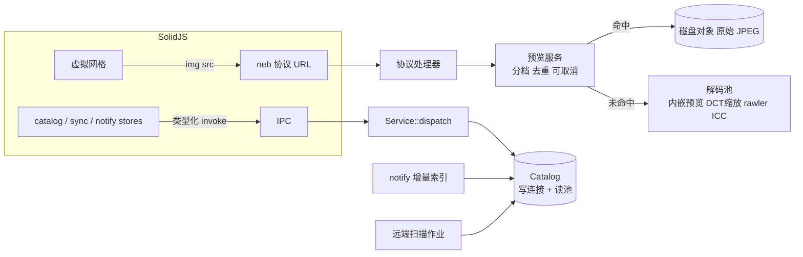

# 治理与重构设计

状态：草案，待评审。日期：2026-11-07。基线版本：0.1.1（提交 `50bdbd0`）。

本文基于对 `packages/ui`、`crates/*` 和发布流程的代码审查，给出界面、文件管理、图像管线和发版更新四条主线的目标设计与分阶段实施方案。文中性能判断来自读代码，尚无运行时测量；第 9 节要求在动工前先建立基线。

## 1. 目标与非目标

### 目标

- 万级到十万级图片的图库仍能流畅浏览：首屏缩略图快速出现，滚动不卡顿，内存不随浏览量线性增长。
- 界面从“文件浏览器 + 设置面板”演进为照片管理工具：选片、批量整理、键盘优先。
- 文件移动、改名不丢失用户数据（评级、裁剪）。
- 正式包通过 GitHub Release 自动构建、签名、发布，已安装用户可在应用内更新。
- 前后端代码结构可演进：单文件职责清楚，接口有类型，数据库迁移有版本。

### 非目标

- 不引入写回原片的能力。原片只读、配方非破坏的原则不变。
- 不在本轮新增远端协议（SMB、SFTP 等）。
- 不改变“未经实机验收的平台不提供安装包”的发布原则。
- 不追求专业级 RAW 冲印质量；查看与选片优先。

## 2. 必须保留的不变量与优点

重构只替换传输、并发、身份和界面结构，以下内容原样保留并作为回归测试的底线。

后端：

- 导入链路：冻结计划、临时文件、`sync_all`、SHA-256 读回校验、`hard_link` 无覆盖发布（`neb-storage/src/safe.rs`）。源文件永不修改。
- 远端分段读取：强 ETag 或 versionId 锁定、严格校验 206 与 Content-Range、显式读取预算，超出时返回 `E_DOWNLOAD_REQUIRED`，不悄悄退化为整份下载（`neb-storage/src/range_reader.rs`）。
- 缓存的预约、校验、硬链接发布、迁移日志、固定（pin）与租约保护（`neb-core/src/cache.rs`）。
- 凭据隔离：不进 SQLite、日志、配置和 UI 响应。
- 解码防御上限（像素数、字节数、`image::Limits`、`catch_unwind`）。
- 来源标记诚实（`raw_demosaic`、`embedded_jpeg`、`remote_embedded_jpeg`），导出拒绝用内嵌预览冒充原图。
- `coordinate_mapping` 统一描述方向、裁剪与对焦框坐标。
- 核心逻辑不依赖 Tauri；CLI 与桌面共用 `Service::dispatch`。

前端：

- 请求令牌隔离迟到结果、`updateSequence` 覆盖、`disposed` 守卫。
- 跨窗口同步时后台核对、不清空网格、保留滚动与选择。
- 调度器只撤销未派发请求的诚实语义（`concurrency.ts`）。
- `--nl-*` 设计 token、深浅主题、照片专用暗色画布、reduced-motion 支持、统一断点。
- 对话框焦点陷阱与焦点归还、输入框内屏蔽快捷键。
- 浏览器演示模式与 Playwright 走同一 UI 路径。

## 3. 现状问题

按影响排序，每条附主要证据位置。

### 3.1 图像字节通道

- 预览以 `data:image/jpeg;base64,...` 经 JSON IPC 返回（`neb-core/src/imaging.rs:542`），前端直接赋给 ``。一张 2400px 预览在路上至少经历 JPEG 编码、base64、`Value` 克隆入内存缓存、序列化落盘、IPC 序列化、JS 解析、浏览器解码等多次整份拷贝，体积膨胀约 33%，浏览器无法按 URL 缓存。CSP 也为此放开了 `img-src data:`。
- 磁盘缓存存的是 JSON 包裹的 base64（`neb-service/src/remote_cache.rs` 序列化后经 `neb-core/src/cache.rs` 的 `preview_put` 写入），内存缓存是 `VecDeque` 线性查找，命中时克隆大字符串（`neb-core/src/catalog.rs` 的 `previews`）。
- 没有缩略图分档。网格固定请求 `max_size: 420`（`PhotoView.tsx:59`），查看器请求 2400（`PhotoView.tsx:190`），后端接受 32–4096 任意值并原样写入缓存键。前端改尺寸即全部失效。

### 3.2 RAW 与解码

- 本地 RAW 缩略图优先完整传感器解码，失败才回退内嵌 JPEG（`imaging.rs:302`）。满屏 NEF 的网格每格都要读几十 MB 并去马赛克。
- `rawloader 0.37.2` 已停止维护，不支持 CR3；同一文件被 `decode_dummy` 与完整解码解析两次。
- JPEG 完整解码后再缩放，没有 DCT 域缩放。
- 无色彩管理：ICC 被丢弃，广色域 JPEG 显示偏淡；导出剥离 EXIF 与 ICC。

### 3.3 Catalog 并发与扫描

- 整个 catalog 共用一个 `Mutex<Connection>`（`catalog.rs:25`），读写全部串行。
- `synchronous=FULL`（`catalog.rs:43`），扫描逐行自动提交，丢失检查逐条 `UPDATE`，`finish_remote_scan`（`catalog.rs:905`）同样不包事务。
- `list_assets`（`catalog.rs:1271`）每次翻页把全库配对成员与命中 ID 拉入内存再 skip/take，且按创建时间排序时在查询路径同步调用 `backfill_created_at` 触发文件系统 IO（`catalog.rs:1305`）。
- `CacheManager` 每次操作新开 SQLite 连接、拿进程间文件锁并执行 `recover()`（`cache.rs:253`、`cache.rs:1401`）。
- 缓存表用 `CREATE TABLE IF NOT EXISTS` 堆叠，没有版本号；索引缺少带 `library_id` 的复合索引；FTS5 索引整个 `metadata_json`。
- 后端全同步，Tauri 侧以 `spawn_blocking` 包装（`neb-app/src/main.rs:25`），请求发出后无法取消；远端下载槽 `Condvar` 无超时等待。

### 3.4 资产身份与文件管理

- 资产身份是 `UNIQUE(library_id, path_key)`（`schema.sql:27`）。文件移动或改名后旧记录标为 missing，新路径生成新 ID，评级与裁剪留在孤儿记录上。
- 索引阶段不计算内容指纹，不记录 inode 或 Windows FileId。
- 没有文件监听，只能手动全量扫描（`WalkDir`，`catalog.rs:976`），扫描期间持有库独占锁。

### 3.5 前端结构

- `ManagementApp.tsx` 1297 行、31 个 signal，承担导航、库 CRUD、分页、筛选、详情、评级裁剪、跨窗口事件队列、键盘和内联设置页。`Dialogs.tsx` 668 行、`CacheSettings.tsx` 801 行。
- `styles.css` 2136 行全局作用域，token 执行不彻底：大量硬编码 `gap`/`padding`、`inspector.css` 与 `viewer.css` 中的 hex、少量 600 字重。
- `api.ts` 的 `execute<T>(command: string)` 是字符串命令，返回类型由调用方断言。
- 网格没有虚拟化，`<For each={assets()}>` 渲染全部已加载项，靠“载入更多”按钮翻页；每个缩略图各建一个 `IntersectionObserver`（`PhotoView.tsx:89`）；调度队列是 FIFO，快速滚动时优先完成已划过的项。

### 3.6 界面、功能与信息层级

- 导航：点侧栏“图片库”会清空当前库、筛选和滚动（`ManagementApp.tsx:244` 起的 `navigate`）。网格内没有库切换器。存储源与存储卡用 `hidden` 保活，图片库与设置用 `Show` 卸载，生命周期不一致。
- 库卡片页只有路径和类型，没有封面、数量、扫描时间。“设置/移除”在卡片和库头部重复出现，破坏性的“移除”与“扫描更新”平级。
- 工具栏挤着搜索、三个下拉、独立升降序下拉、补索引控件和缩略图滑杆；缩略图滑杆在工具栏与设置页重复。
- 消息系统分裂为 `syncError`、`error`、`notice` 三条横幅加底部 `busy`，没有队列和自动消退。
- 缓存设置以多级标题整段嵌入设置页；“运行环境”直接输出 JSON；版本号写死为“0.1 Alpha”（`ManagementApp.tsx:1289`），实际为 0.1.1。
- 加载态只有文字，没有骨架屏（`--nl-skeleton` 已定义未使用）；检查器加载时整块替换为 spinner，布局跳动。
- 缺少照片管理基本能力：多选与批量、剔除旗标与色标、↑↓/Home/End/PageUp/PageDown、右键菜单、拖入建库、EXIF 维度筛选、对比视图。
- 查看器切图先 `setAsset(undefined)`（`Viewer.tsx:165`）再请求预览，每次都有空白期，也不预取相邻图。
- 网格每张缩略图是独立 `<button>`，几百张图即几百个 Tab 停靠点。
- 动效仅有按钮背景过渡、spinner 与抽屉滑入；网格到查看器、检查器开合没有过渡。

### 3.7 发版与更新

- 发布完全手工：本地构建 NSIS，`scripts/package-release.py` 生成 ZIP、清单与校验表，再手工上传。CI 只做验证，没有 release 作业。
- 没有应用内更新。已安装用户只能自行下载新安装器。
- `tauri.conf.json` 的 `bundle.targets` 为 `"all"`，Windows 上会同时产出 MSI 与 NSIS，实际只发布 NSIS。

## 4. 目标架构



核心变化：

1. 字节与元数据分道。图片字节走自定义协议，元数据走 IPC。
2. 缩略图固定分档，磁盘缓存存原始图像对象。
3. Catalog 读写分离，迁移统一版本化，分页下推到 SQL。
4. 资产身份与文件位置分离，移动可识别。
5. 前端按 store / page / component 分层，网格虚拟化，调度按可见性排优先级。

## 5. 主线 A：图像管线

### A1. 自定义协议

在 `neb-app` 用 `tauri::Builder::register_asynchronous_uri_scheme_protocol("neb", ...)` 注册协议，处理器把请求转交 `neb-service` 的预览服务（服务本身不依赖 Tauri，CLI 可直接调用同一函数写文件）。

URL 形态：

```
neb://localhost/preview/{asset_id}/{tier}?rev={fingerprint}&crop={0|1}
```

- Windows WebView2 上自定义协议实际为 `http://neb.localhost/...`，macOS/Linux 为 `neb://localhost/...`。前端统一用 `@tauri-apps/api/core` 的 `convertFileSrc(path, 'neb')` 生成，不手拼。
- `rev` 由现有指纹（本地 `mtime + size + crop`，远端 fingerprint）派生，内容变化即换 URL，因此响应可带长期 `Cache-Control: max-age=31536000, immutable` 与 `ETag`。
- 错误语义：404 资产不存在；409 需要下载原图（对应 `E_DOWNLOAD_REQUIRED`）；415 格式不支持；503 繁忙。正文为与 IPC 相同结构的 JSON 错误，前端据此展示现有的“获取原图后重试”入口。
- CSP 调整：`img-src 'self' blob: neb: http://neb.localhost`，移除 `data:`（字体若仍需 `data:` 则单独保留在 `font-src`）。
- 浏览器演示模式：`demo.ts` 提供同名 URL 生成函数，返回 `blob:` URL，保持演示与 Playwright 同路径。

`asset.preview` IPC 保留，但只返回 `{url, width, height, source, coordinate_mapping}`。保留一个版本的兼容字段期以便分步迁移，随后删除 `data_url`。API 变更同步写入 `docs/API.md`。

### A2. 分档与缓存对象

| 档位    | 最长边 | 用途                             |
| ------- | ------ | -------------------------------- |
| `t256`  | 256    | 小网格、胶片条                   |
| `t512`  | 512    | 默认网格（含 2x 屏）             |
| `t1024` | 1024   | 大网格、检查器                   |
| `p2560` | 2560   | 查看器                           |
| `full`  | 原始   | 1:1 与导出，按需生成，不长期缓存 |

- 前端按 `ceil(thumbSize × devicePixelRatio)` 向上取档。
- 后端只接受档位名，不再接受任意 `max_size`。
- 小档可由已缓存的大档降采样生成，不再回源解码。
- 磁盘对象为原始 `.jpg`（后续可评估 WebP），元数据（宽高、来源、坐标映射）存 `cache_objects` 的列。写入沿用预约、校验、硬链接发布流程，但 `sync_all` 移出请求线程，由后台写入队列完成；队列满时同步返回结果、跳过落盘，而不是丢弃。
- 内存缓存改为按字节计量的 LRU（`lru` crate 或 `HashMap + 链表`），存 `bytes::Bytes`，命中零拷贝。
- 缓存键升级会使旧预览缓存失效：迁移时将旧 JSON 预览对象标为可清理，不尝试转换。原图缓存与固定快照不受影响。

### A3. 解码策略

缩略图档（`t256`–`t1024`）解码优先级：

1. RAW 与 TIFF：内嵌 JPEG（复用 `embedded_preview.rs`），尺寸足够即用。
2. JPEG：`turbojpeg` 的 1/2、1/4、1/8 DCT 缩放解码，取不小于目标档的最小比例。
3. 其他栅格：`image` 解码。
4. RAW 无可用内嵌预览时才走传感器渲染。

缩放统一用 `fast_image_resize`。查看器 `p2560` 对 RAW 默认仍取内嵌预览，提供“原始渲染”切换；导出继续强制传感器解码。

RAW 后端：用 `rawler`（dnglab 项目，纯 Rust，支持 CR3）替换 `rawloader`，一次解析同时得到头信息与传感器数据。先在测试样本集上做并行对比，覆盖率与输出不低于现状后再切换。LibRaw FFI 作为可选的后续高质量渲染后端，不在本轮。

色彩管理：用 `lcms2`（或纯 Rust 的 `qcms`）读取 ICC 并转换到 sRGB；无 ICC 时按 sRGB 处理。导出 JPEG 保留 sRGB ICC 与精简 EXIF（拍摄参数、时间，方向置 1），不写入厂商私有 MakerNote；是否保留 GPS 作为导出选项。

### A4. 并发与取消

- 预览服务内部用有界优先队列替代 FIFO：查看器高于缩略图，同类按前端提交的优先级（离视口中心距离）排序。
- 同一 `(asset, tier, rev)` 的并发请求合并为一次解码。
- 协议请求被 WebView 中止（图片离屏、`src` 被清空）时，处理器丢弃结果；解码在“读取完成、解码完成、缩放完成”三个检查点读取取消标记。
- 远端下载槽改为带超时、可取消的等待，超时返回 503，前端按退避重试。

### A5. 后台预生成

索引完成后由低优先级线程池为新资产生成 `t512`，空闲时补 `t256`。可在设置中关闭，受缓存总上限约束，遵守现有清理与 pin 规则。

## 6. 主线 B：Catalog 与文件管理

### B1. 连接与事务

- `Core` 持有一个写连接（`Mutex`）和一个只读连接池（`r2d2_sqlite`，默认 4 个）。WAL 下读不阻塞写。
- WAL 模式下改用 `synchronous=NORMAL`。导入的业务提交点（作业记录）仍在显式事务内完成，崩溃最多丢失最后一次未 checkpoint 的提交，不影响原片与已发布文件。
- `CacheManager` 使用常驻连接；`recover()` 只在启动和缓存迁移后执行一次。进程间文件锁只保留在跨进程写入关键段。
- `catalog/asset-locks` 目录锁改为进程内锁表，跨进程场景（CLI 与桌面同时运行）通过 SQLite 事务保证。

### B2. 迁移与索引

- 引入 `rusqlite_migration`，catalog 与 cache 两个数据库各自一条版本链。现有 v1–v5 迁移原样纳入，cache 表以“当前结构为 v1”登记。迁移继续在 IMMEDIATE 事务内执行，不访问原片与网络。
- 新增复合索引：`(library_id, rating)`、`(library_id, kind)`、`(library_id, availability)`、`(library_id, source_key)`，以及排序字段与 `library_id` 的组合索引。删除被覆盖的单列索引。
- FTS5 改为只索引 `filename`、相机、镜头、关键词等结构化字段，由触发器维护。

### B3. 分页下推

- RAW/JPEG 配对在索引时物化为 `pair_group_id` 列（无配对时等于自身 ID），列表查询以 `pair_group_id` 分组，直接 `ORDER BY ... LIMIT`。
- 主排序采用 keyset 分页（`(sort_key, id) > (?, ?)`），同时保留 `offset` 以支持虚拟滚动跳转；`total` 用单独的 `COUNT` 查询并缓存到筛选条件变化为止。
- `created_at` 补齐移出查询路径，改为后台作业（复用 `capture_index` 的作业框架），未补齐项按现有规则排在末尾。

### B4. 资产身份

新增 schema v6：

```
assets(id, library_id, rating, crop_json, flag, color_label, pair_group_id, ...)
asset_files(asset_id, path_key, path, size, mtime_ns, file_id, quick_hash, seen_scan, availability)
```

- `assets.id` 是稳定 ID，用户数据只挂在 `assets` 上。
- `file_id`：Unix 为 `(dev, ino)`，Windows 为卷序列号加 FileId。`quick_hash` 为 blake3（文件头 64KiB + 尾 64KiB + 大小）。
- 扫描发现新路径时，先在同库 missing 记录中按 `file_id`，再按 `quick_hash + size` 匹配；唯一匹配判为移动，更新 `asset_files` 并保留 `assets`。多重匹配不自动合并，标为“可能重复”交给用户。
- 远端来源用 ETag/versionId 加大小作为弱匹配依据，只在列举完整时执行。
- 迁移：现有每条 asset 拆为一条 `assets` 加一条 `asset_files`，`file_id` 与 `quick_hash` 留空，下次扫描时补齐。迁移不读原片。
- 导入去重继续使用 SHA-256，`quick_hash` 只用于移动识别，不用于判定内容相同。

### B5. 扫描与增量索引

- 扫描为后台作业，报告进度，支持停止；按 500 行一个事务批量写入。
- 丢失检查改为扫描时写 `seen_scan`，结束后一条 `UPDATE ... WHERE library_id=? AND seen_scan<?`。
- RAW 的 `inspect` 只读头部与 EXIF 获取尺寸和拍摄参数，不再调用 `rawloader::decode_dummy`（`imaging.rs:240`）。
- 本地库用 `notify` + `notify-debouncer-full` 监听，事件写入 `fs_events` 表，由后台索引器合并处理。网络盘、可移动卷等监听不可靠的位置退回启动时与定时的轻量扫描（只比对 `size + mtime`）。
- 扫描不再全程持有库独占锁；写入批次之间释放，用户的评级等操作可穿插执行。

## 7. 主线 C：界面与交互

### C1. 信息架构

```
侧栏
├─ 图库
│   ├─ 库 A    1,284 · 已同步
│   └─ 库 B    32,051 · 扫描中 42%
├─ 来源
│   ├─ 存储源
│   └─ 存储卡导入
└─ 设置
主区（选中库时）
├─ 头部：库名 · 计数 · 扫描 · ⋯（库设置 / 移除）
├─ 筛选条：搜索 · 筛选 chip（评级、旗标、格式、日期、机身）· 排序字段 + 方向按钮 · 缩略图尺寸
├─ 虚拟网格
├─ 检查器（可停靠、可折叠，开合不卸载）
└─ 底部任务托盘（扫描、补索引、导入、缓存迁移）
设置页（左侧子导航）
├─ 外观
├─ 缓存与离线（拆自 CacheSettings：容量与位置 / 获取策略 / 清理）
├─ 存储与证书
├─ 快捷键
└─ 关于与诊断（版本、检查更新、运行环境）
```

- 去掉库卡片中间页。无库时主区显示空状态与“添加图库”。
- 切换侧栏分区不丢失当前库、筛选与滚动；所有分区统一保活或统一按路由恢复状态（推荐统一保活，内存由虚拟网格兜底）。
- 移除库收进“⋯”菜单，并保留现有确认文案。
- 缩略图尺寸只保留筛选条上的一个控件，设置页不再重复。
- 版本号由构建时从 `package.json` 注入。

### C2. 选片能力

- 选择模型：`Set<id>` 加锚点。单击单选，Ctrl/Cmd 切换，Shift 范围选择，Ctrl/Cmd+A 全选当前筛选结果（按 ID 查询，不要求全部加载）。
- 旗标：P 留用、X 剔除、U 取消；色标 6–9；星级 0–5。均可批量应用，写入走单个事务，跨窗口同步沿用现有事件机制。
- 批量操作：评级、旗标、色标、导出、移出图库（不删除原片）。
- 右键菜单：打开查看器、在查看器裁剪、显示于文件夹、刷新原图、复制路径。
- 拖入目录到侧栏或空状态即建库。
- 筛选维度增加旗标、色标、日期范围、机身、镜头。保存的筛选（智能相册）放到下一轮。

### C3. 键盘与无障碍

- 网格使用 `role="grid"`，roving tabindex，整个网格只占一个 Tab 停靠点，选中项 `aria-selected`。
- 方向键按行列移动，Home/End 到首尾，PageUp/PageDown 翻一屏，Space 快速预览，Enter 打开查看器。
- 快捷键集中定义在一处，设置页“快捷键”由同一份定义渲染。

### C4. 加载与反馈

- 网格未加载项显示静态骨架格（`--nl-skeleton` 底色，不加闪光动画）。
- 检查器加载保留布局，字段级占位，不整块替换。
- 查看器切图：保留旧图直到新图就绪；先显示已缓存的缩略图档放大占位，再替换为 `p2560`；预取当前项前后各一张（viewer 通道）。
- 通知统一为 toast 队列：成功与信息自动消退（4 秒），错误常驻且可展开详情（扫描异常全部可查看）。长任务进入底部任务托盘，显示进度、停止与重试。

### C5. 动效规范

沿用 `tokens.css` 的三档时长与 `--nl-ease-standard`：

| 场景                   | 时长         | 说明                                            |
| ---------------------- | ------------ | ----------------------------------------------- |
| 悬停、选中、按钮反馈   | fast 120ms   | 背景与边框过渡                                  |
| 检查器、抽屉、菜单开合 | normal 180ms | 位移与透明度                                    |
| 网格进入查看器         | slow 240ms   | View Transitions API 缩放转场，不支持时直接切换 |
| toast 进出             | normal 180ms | 透明度与少量位移                                |

`prefers-reduced-motion` 下全部降为即时切换。不使用装饰性动画。

### C6. 前端结构

```
src/
├─ api/   commands.ts（CommandMap 类型）、client.ts、preview-url.ts、demo/
├─ stores/       catalog.ts、selection.ts、asset-sync.ts、notifications.ts、tasks.ts、preferences.ts
├─ pages/ LibraryBrowser/、Sources/、Import/、Settings/
├─ components/   grid/（VirtualGrid、Thumbnail、visibility.ts）、inspector/、viewer/、dialogs/、ui/（Button、Field、Menu、Toast、Chip）
├─ styles/       tokens.css、semantic.css、base.css、components/*.css、features/*.css
└─ lib/   concurrency.ts、keyboard.ts、theme.ts 等纯逻辑
```

- `ManagementApp.tsx` 拆分后仅保留壳层与路由，单文件目标不超过 300 行。
- `CommandMap` 形如 `{ 'asset.list': [AssetQuery, AssetListResult], ... }`，`execute<K extends keyof CommandMap>` 自动推导参数与返回值；`demo.ts` 实现同一映射，类型检查保证演示与真实命令一致。
- 虚拟网格：`@tanstack/solid-virtual`（锁定版本），按容器宽度与 `thumbSize` 计算列数，渲染视口上下各 2 屏；滚动接近已加载末端时自动拉取下一页；全局只有一个 `IntersectionObserver` 向调度器报告可见项与距离。
- 调度器：等待队列改为优先队列，支持 `reprioritize`；保留只撤销未派发请求的语义，派发后由协议请求的中止实现后端取消（见 A4）。
- CSS：按 `styles/` 结构拆分 `styles.css`；加 stylelint 规则禁止 `gap`、`padding`、`margin` 使用裸 px，禁止 hex 色值，字重限定 400/500；直方图与查看器颜色进 token。

## 8. 主线 D：发版与自动更新

### D1. 机制

Tauri 2 的应用内更新由官方插件 `tauri-plugin-updater` 提供（需另行安装，不是内置功能），重启由 `tauri-plugin-process` 提供。更新包必须用 updater 专用密钥签名，验证不可关闭。

- 该密钥与 Windows Authenticode 代码签名相互独立。当前未做代码签名，只会让 SmartScreen 显示警告，不影响自动更新。
- 私钥丢失后，已安装用户将无法再收到任何更新。生成后立即存入密码管理器与 GitHub Secrets（`TAURI_SIGNING_PRIVATE_KEY`、`TAURI_SIGNING_PRIVATE_KEY_PASSWORD`），并记录轮换流程。

### D2. 配置

`crates/neb-app/Cargo.toml` 增加 `tauri-plugin-updater` 与 `tauri-plugin-process`（桌面目标），`packages/ui` 增加 `@tauri-apps/plugin-updater` 与 `@tauri-apps/plugin-process`，版本与现有插件一样精确锁定。

`tauri.conf.json`：

```json
{
  "bundle": {
    "targets": ["nsis"],
    "createUpdaterArtifacts": true
  },
  "plugins": {
    "updater": {
      "pubkey": "<公钥内容>",
      "endpoints": ["https://github.com/<owner>/nebulume/releases/latest/download/latest.json"],
      "windows": { "installMode": "passive" }
    }
  }
}
```

- `targets` 收窄为实际发布的 NSIS，避免 MSI 与 NSIS 并存导致 `latest.json` 指向不明确。其他平台通过验收后再加入。
- `capabilities/main.json` 增加 `updater:default` 与 `process:allow-restart`，查看器窗口不授予。
- 更新检查在 Rust 侧注册插件时以 `#[cfg(desktop)]` 限定。

### D3. 发布流水线

新增 `.github/workflows/release.yml`，由推送 `v*` 标签触发：

1. 校验标签版本与 `Cargo.toml`、`package.json`、`packages/ui/package.json`、`tauri.conf.json`、`Cargo.lock` 一致，`CHANGELOG.md` 含该版本条目。
2. 复用 `ci.yml` 的全部检查（fmt、clippy、Rust 测试、UI 单测、类型检查、构建）。浏览器工作流测试在 Windows runner 上以 Edge 执行。
3. `tauri-apps/tauri-action` 构建 NSIS、用 updater 密钥签名、生成 `latest.json`，创建草稿 Release。
4. 运行 `scripts/package-release.py` 生成 ZIP、`manifest.json`、`SHA256SUMS.txt`，验证记录由第 2 步的实际结果生成。脚本的上传白名单需扩展为：安装器、安装器 `.sig`、ZIP、`latest.json`、`manifest.json`、`SHA256SUMS.txt`；`SHA256SUMS.txt` 同时覆盖 `.sig` 与 `latest.json`。
5. 回读草稿：资产名称、数量、大小与白名单一致，远端摘要与本地一致，`latest.json` 中的 URL 指向本 Release 资产、签名与 `.sig` 内容一致。
6. 人工确认后转为正式发布。`releases/latest` 只指向正式发布，草稿与预发布不会被已安装客户端拉到。

`docs/RELEASING.md` 相应改写为“流水线为主、本地为备”，保留现有的不覆盖已发布资产、失败后先回读再补救的规则。

`latest.json` 中任意一个平台条目格式错误会导致所有平台更新失败，因此只写入已验收平台（当前仅 `windows-x86_64`），并在回读步骤中解析校验。

### D4. 应用内体验

- 启动 10 秒后静默检查一次，之后每 24 小时一次；失败不打扰用户，只在“关于与诊断”页显示上次检查结果。
- 发现新版本时在任务托盘显示提示，点开展示版本号与更新说明（来自 `latest.json` 的 `notes`）。
- 用户确认后下载，显示进度；下载完成后提供“立即重启”和“下次启动时安装”。
- “关于与诊断”页提供手动“检查更新”和“自动检查”开关。
- Windows 开始安装时应用会被安装器结束：安装前先停止后台作业、等待缓存写入队列落盘、写入当前窗口状态。
- 便携 ZIP 版不支持自动更新，检测到非安装版运行时隐藏更新入口，说明里写明。
- 0.1.x 已安装用户没有更新器，需要手动安装一次带更新器的版本，此后自动更新生效。发布说明中注明。

### D5. 后续

- 预发布通道：另设 `latest-beta.json` endpoint，由设置项切换，Rust 侧在运行时覆盖 endpoints。
- Windows 代码签名：评估 Azure Trusted Signing 等方案，消除 SmartScreen 警告。
- macOS 与 Linux：通过实机验收后，加入 `latest.json` 的 `darwin-*` 与 `linux-*` 条目。

## 9. 实施阶段

| 阶段 | 内容                                                                          | 依赖         | 完成标准                                                                                                                  |
| ---- | ----------------------------------------------------------------------------- | ------------ | ------------------------------------------------------------------------------------------------------------------------- |
| 0    | 性能基线                                                                      | 无           | 万级与十万级合成图库下记录扫描耗时、首屏缩略图时间、列表翻页耗时、滚动 5 分钟后的内存与 DOM 节点数                        |
| 1    | 发版与自动更新（D）                                                           | 无           | 标签触发流水线产出已签名草稿；从 N 版本经应用内更新到 N+1 版本的 Windows 实机验证通过                                     |
| 2    | 字节通道与分档（A1、A2、A3 中的内嵌预览优先），扫描事务化（B1 部分、B5 部分） | 0            | 前端不再出现 `data_url`；网格与查看器走 `neb` 协议；RAW 网格首屏时间、扫描耗时相对基线显著下降，数字写入 `docs/STATUS.md` |
| 3    | 虚拟网格、调度器优先队列、ManagementApp 拆分、类型化 API（C6）                | 2 的协议接口 | 十万级图库滚动时 DOM 节点数与内存有上界；单文件不超过 300 行；现有 Playwright 用例全部通过                                |
| 4    | 信息架构、通知与任务托盘、查看器渐进加载、键盘与无障碍（C1、C3、C4、C5）      | 3            | 交互规范更新到 `docs/INTERACTION.md`；新增键盘与选择的浏览器测试                                                          |
| 5    | Catalog 读池、迁移版本化、分页下推、资产身份 v6、增量索引（B）                | 2            | 移动与改名后评级、裁剪保留的测试通过；v5 到 v6 迁移在真实旧库副本上验证                                                   |
| 6    | 选片能力（C2）、rawler、DCT 缩放、色彩管理、取消（A3、A4、A5）                | 3、5         | rawler 在样本集上覆盖率不低于现状；广色域样本显示与参考一致                                                               |

阶段 1 与阶段 2 可以并行。阶段 2 内前后端两部分以 A1 的 URL 与错误语义为接口约定，约定写入 `docs/API.md` 后可并行开发。阶段 4 与阶段 5 可交错进行。

每个阶段结束时更新 `docs/STATUS.md`、`docs/API.md` 与 `CHANGELOG.md`，只记录实际交付与实际验证结果。

## 10. 测试策略增补

- 预览协议：命中、未命中、`rev` 变化、需要下载、取消、并发合并、CSP 生效。
- 分档：任意尺寸请求映射到正确档位，小档由大档降采样，旧缓存迁移后可清理。
- 资产身份：本地移动、改名、跨目录移动、多重匹配、远端 ETag 匹配、迁移回滚。
- 扫描：批量事务中途失败后可重扫且无重复；监听事件风暴的去抖。
- 前端：引入 `@solidjs/testing-library`，覆盖 catalog store 分页与同步交错、选择模型、虚拟网格窗口计算；Playwright 增加万级演示数据的滚动基线（DOM 节点数、内存上限）。
- 更新：流水线回读脚本的单测（白名单、摘要、`latest.json` 结构）；应用内更新在 Windows 实机上的升级、取消与失败回退。

## 11. 风险与待决问题

| 项                   | 说明                                                                   | 建议                                                                                    |
| -------------------- | ---------------------------------------------------------------------- | --------------------------------------------------------------------------------------- |
| 协议跨平台差异       | Windows 为 `http://neb.localhost`，其他平台为 `neb://`                 | 一律用 `convertFileSrc` 生成，CSP 同时列出两种                                          |
| `synchronous=NORMAL` | 断电时可能丢失最后一次提交                                             | 仅影响索引与评级的最后一次写入；导入作业记录维持显式事务；在 `ARCHITECTURE.md` 记录取舍 |
| rawler 覆盖差异      | 个别机型可能不如 rawloader                                             | 并行对比期保留回退路径，样本集验证后切换                                                |
| turbojpeg 原生依赖   | 增加 C 依赖与交叉编译复杂度                                            | 先用 `image` 内置 zune-jpeg 加降采样验证收益，确有必要再引入                            |
| 资产身份迁移         | 一次性结构变更，影响所有查询                                           | v6 迁移在真实旧库副本上演练，迁移前自动备份 `catalog.sqlite3`                           |
| updater 私钥         | 丢失即断更                                                             | 双处离线备份，记录在发布清单中                                                          |
| 待决                 | 统一保活还是路由恢复状态；导出是否保留 GPS；是否引入 WebP 作为缓存格式 | 阶段 4 前评审决定                                                                       |
