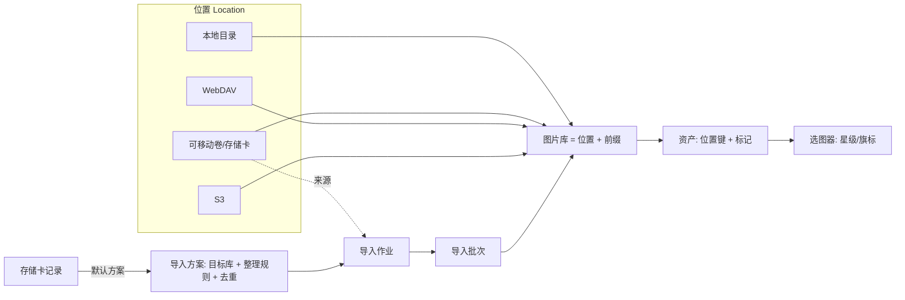

# 位置 / 图片库 / 导入 / 选图 / 设置 治理设计

日期：2026-10-22 · 基线：Nebulume 0.1.0（catalog schema v5）

## 1. 为什么要做

0.1.0 已经把安全读取、缓存、导入校验做得很扎实，但领域模型是“按功能长出来的”，不是“按概念分层的”：

| 现状问题 | 具体表现 |
|---|---|
| 存储抽象不对称 | 远端是 `storage.json` 中的存储源；本地库直接写 `libraries.root`，旧 `kind:local` 源仅兼容保留。`libraries` 同时有 `root` / `storage_id` / `source_prefix` 三套定位。远端 `Asset.path` 是缓存路径，逻辑位置与物理位置混用。 |
| 存储卡游离在体系外 | 卷来自 app 层 `list_volumes`，导入来源只是路径字符串；卡没有身份，无法记住偏好，格式化后更无法认回。 |
| 导入与存储源割裂 | 导入目标只能是本地库 `root`（`neb-ingest` 直接操作 `Path`）；远端只读，无法直接导入 NAS。整理规则只有 `preserve`/`date` 两种且每次手填。 |
| 设置页混杂 | 同一页面堆放应用偏好（主题、缩略图）、本机资源（缓存）、只读诊断（运行能力 JSON）、静态帮助（快捷键）；库级、源级配置散落在各自对话框，没有“谁拥有这项配置”的规则。 |
| 选图缺少数据基础 | 只有 0–5 星；无留用/淘汰旗标，无批次概念，无连续打标交互。 |

目标是建立与一般文件管理应用同等层次的抽象：**位置 → 图片库 → 资产**，存储卡与 NAS 都是位置；导入是“位置到图片库”的受管流程；选图只是库内标记。

## 2. 目标 / 非目标 / 反目标

**目标**
- 一个统一的“位置”抽象覆盖本地目录、可移动卷、WebDAV、S3；库可建在任意可读位置上，导入可写入任意可安全写入的位置（含 NAS）。
- 存储卡有持久身份，支持格式化后把新卡绑定到已有记录。
- 导入目录自动整理为通用、可组合的规则（日期层级预设、类型分目录、未知日期策略），以“导入方案”保存与复用。
- 选图器（查看窗口的选图模式，从图片库筛选结果进入）：快捷键打星/旗标、确认动效、可配置自动下一张、单张与并排对比。
- 设置按“配置归属”重组，每一项配置只有一个家。

**非目标（本轮不做）**
- 删除、移动、重命名原片（包括“清空淘汰”）；导入后清理卡内原件。
- 双向同步、远端→远端复制、多目标备份、断点续传。
- 任意路径模板/脚本；视频导入（另立项）。
- 相册/智能集合（模型预留，不实现）。

**反目标（即便功能可用也算失败）**
- 任何选图操作改动原片或触发网络写入。
- 为了统一抽象而破坏现有库的资产 id、评级、裁剪，或要求用户重建库。
- 远端写入在服务器不支持无覆盖发布时“尽力而为”地覆盖。
- 把文件修改时间冒充拍摄日期用于归档（除非用户显式选择该回退，且在计划中标明）。
- 用户必须先理解“位置”才能用：选一个文件夹建库的路径必须仍是一步完成。

## 3. 概念模型



| 概念 | 定义 | 拥有的配置 |
|---|---|---|
| 位置 Location | 一个可寻址的存储根。种类：`local` / `removable` / `webdav` / `s3`。 | 名称、endpoint/路径、bucket/region、凭据引用、TLS 指纹、能力（读、安全写）。 |
| 卷身份 Volume Identity | `removable` 位置的持久身份（卷上标识文件），跨插拔、跨挂载路径存在。存储卡与外接库盘共用这一机制。 | 标识 id、最近挂载路径。 |
| 存储卡 Card | 用作导入来源的 `removable` 位置的附加记录。 | 名称、身份标识、默认导入方案、上次导入水位。 |
| 图片库 Library | 位置内一个根键下的影像集合与其索引。 | 名称、根键、RAW/JPEG 合并、扫描行为。 |
| 资产 Asset | 库内一个文件。逻辑地址 = (location_id, key)。 | 星级、旗标、裁剪配方（库内标记）。 |
| 导入方案 Import Preset | 可复用的“往哪导、怎么整理”。 | 目标库、整理规则、去重范围、未知日期策略。 |
| 导入批次 Import Batch | 一次已执行导入的不可变记录，同时是库内可筛选维度。 | 无（只读）。 |

规则：**连接相关的属于位置；索引与标记属于库；“怎么导”属于方案；“这张卡默认用哪个方案”属于卡；外观与本机资源属于应用。**

## 4. 数据模型

### 4.1 位置表（新，进入 SQLite）

位置配置从 `storage.json` 迁入 catalog，使库外键可约束。秘密仍只在系统凭据库，SQLite 只存非秘密字段。

```sql
CREATE TABLE locations(
  id TEXT PRIMARY KEY,
  kind TEXT NOT NULL CHECK(kind IN ('local','removable','webdav','s3')),
  name TEXT NOT NULL,
  endpoint TEXT NOT NULL,          -- local: 绝对路径；removable: 最近一次挂载路径；remote: URL
  root TEXT NOT NULL DEFAULT '',   -- 远端前缀
  bucket TEXT, region TEXT,
  tls_certificate_sha256 TEXT,
  remember_credentials INTEGER NOT NULL DEFAULT 0,
  implicit INTEGER NOT NULL DEFAULT 0,  -- 由“选文件夹建库”自动创建，不在位置列表中突出显示
  created_at TEXT NOT NULL
);
```

- `connected`、`credential_status`、能力探测结果是运行时状态，不落库（沿用现有语义）。
- 能力：`read` 恒定；`safe_write` 由显式“测试写入”得出并在当前进程缓存（借鉴 photo-import-assistant：写入并读回随机小文件，插卡/计划时的预检只读，不把可访问误报为可写）。
- `removable` 位置既可作导入来源（存储卡），也可承载图片库（外接硬盘）。两者都通过卷身份（§6.1）解析当前挂载路径；身份写在卷根 `/.nebulume/volume.json`。
- `implicit=1` 的本地位置：每个直接选目录建立的库各自得到一个隐式位置，root 即该目录。用户永远不需要先“添加位置”。

### 4.2 图片库

```sql
-- v6 起 libraries 以 (location_id, root_key) 定位
ALTER TABLE libraries ADD COLUMN location_id TEXT REFERENCES locations(id);
ALTER TABLE libraries ADD COLUMN prefix TEXT NOT NULL DEFAULT '';  -- 位置内库根前缀（本地隐式位置为 ''）
```

- 旧 `root`、`storage_id`、`source_prefix` 在迁移后只读保留一个版本以便回滚诊断，下一版本删除。
- 新增唯一索引 `UNIQUE(location_id, prefix)`；同一位置可提供多个库（沿用现状）。现有 `root_key`（规范化绝对路径，UNIQUE NOT NULL）不复用，作为遗留列保留，避免重建表；新本地库照常写入以满足约束。【构建者决定，已定】

### 4.3 资产

- 新增 `key TEXT`：资产在其**位置根**内的完整逻辑键（含库 prefix）。远端即原 `source_key`；本地 = 相对位置根的路径（隐式位置下等于相对库根）。唯一约束 `UNIQUE(library_id, key)`。【已定】
- 新增 `sha256 TEXT`（可空）：导入写入时、本地扫描已计算时填入；用于导入去重，避免远端目标反复下载比对（见 §6.3）。
- `path` 不再承担远端缓存路径；实际 I/O 一律经“位置解析器 + 缓存对象”解析。现有 `cache_objects` 已按 root/relative_path 寻址，无需变更。
- 新增标记字段：

```sql
ALTER TABLE assets ADD COLUMN flag TEXT NOT NULL DEFAULT 'none'
  CHECK(flag IN ('none','pick','reject'));
ALTER TABLE assets ADD COLUMN import_batch_id TEXT;  -- 首次由导入产生时写入；扫描发现的为 NULL
CREATE INDEX assets_library_flag ON assets(library_id, flag);
CREATE INDEX assets_library_batch ON assets(library_id, import_batch_id);
```

色标暂不做，`flag` 用 TEXT 而非布尔，留出扩展空间。

### 4.4 存储卡与导入

```sql
CREATE TABLE cards(
  id TEXT PRIMARY KEY,             -- 同时写入卡上标识文件
  location_id TEXT NOT NULL REFERENCES locations(id),  -- kind='removable'
  name TEXT NOT NULL,
  default_preset_id TEXT REFERENCES import_presets(id),
  last_seen_at TEXT, last_import_at TEXT
);
CREATE TABLE import_presets(
  id TEXT PRIMARY KEY, name TEXT NOT NULL,
  library_id TEXT NOT NULL REFERENCES libraries(id),
  rules_json TEXT NOT NULL,        -- 见 §6.2
  created_at TEXT NOT NULL
);
CREATE TABLE import_batches(
  id TEXT PRIMARY KEY, library_id TEXT NOT NULL, card_id TEXT,
  preset_snapshot_json TEXT NOT NULL,  -- 执行时冻结的规则
  started_at TEXT NOT NULL, finished_at TEXT,
  status TEXT NOT NULL, copied INTEGER, duplicates INTEGER, failed INTEGER
);
```

现有导入日志（`import.history`）继续作为逐项审计来源；`import_batches` 是库内可浏览的摘要，`id` 与日志结果 id 一致。

### 4.4a 卷身份

```sql
CREATE TABLE volume_identities(
  id TEXT PRIMARY KEY,               -- 写入卷根 /.nebulume/volume.json
  location_id TEXT NOT NULL UNIQUE REFERENCES locations(id),
  volume_label TEXT, volume_serial TEXT, capacity_bytes INTEGER,  -- 仅作绑定提示
  last_mount_path TEXT, last_seen_at TEXT
);
```

`cards.location_id` 指向的位置必须有卷身份；外接库盘的位置也有卷身份但没有 `cards` 行。

### 4.5 迁移

版本号分配【已定】：**v6 = 选图（`assets.flag`、`assets.import_batch_id`、`assets.sha256`）**，随阶段 B 先发布；**v7 = 位置、库/资产按位置寻址、卡、方案、批次表**，随阶段 A/C 发布。以下为 v6 → v7，单个 IMMEDIATE 事务内完成，不访问网络、不读原片：

1. `storage.json` 中每个远端源 → `locations` 行，**保留原 id**（凭据库条目以源 id 作用域，id 不变则凭据无需重输）。
2. 旧 `kind:local` 源 → `local` 位置（保留 id）。
3. 每个 `storage_id IS NULL` 的本地库 → 新建隐式 `local` 位置，`prefix=''`。迁移不判断是否在可移动卷上（不访问文件系统之外的信息）；之后若该路径位于可移动卷，库页提示“转为可移动位置”，用户确认后写卷身份文件并把位置 kind 改为 `removable`。
4. 回填 `assets.key`：本地 = `path` 相对库根；远端 = `source_key`。
5. 迁移成功后将 `storage.json` 改名为 `storage.json.v5-migrated`，不删除。
6. 资产 id、评级、裁剪、缓存对象引用全部不变。迁移测试必须覆盖：混合库、孤立源、凭据作用域不变、迁移中断重开。

## 5. 位置层（neb-storage）

模块边界【已定】：`locations` 表由 neb-core 的 catalog 持有（与库外键同库）；neb-service 读取位置行并构造 neb-storage 的后端实例，neb-storage 仍不依赖 neb-core，凭据作用域仍以位置 id 为键。

把现在的 `StorageRegistry` + 本地分支收敛为一个接口，本地与远端同等对待：

```rust
trait LocationBackend {
    fn list(&self, prefix: &str, cursor: Option<&str>, limit: usize) -> Result<BrowsePage>;
    fn stat(&self, key: &str) -> Result<EntryMeta>;
    fn open_range(&self, key: &str, version: &Version, range: Range<u64>) -> Result<Reader>;
    fn open(&self, key: &str) -> Result<Reader>;
    // 安全写入：临时对象 → 完整读回 SHA-256 → 无覆盖发布。服务器无法保证无覆盖时返回 E_UNSUPPORTED。
    fn put_new(&self, key: &str, src: &mut dyn Read, size: u64, sha256: &str) -> Result<PutResult>;
    fn probe_write(&self) -> Result<WriteCapability>;   // 显式测试，写入并清理随机小对象
}
```

- `local` / `removable`：沿用 `safe.rs` 的 canonicalize、根检查、硬链接无覆盖发布。
- `webdav`：`PUT` 到临时名 → `GET` 读回校验 → `MOVE` + `Overwrite: F`；不支持 `Overwrite:F` 时失败，不降级覆盖。
- `s3`：`PUT` with `If-None-Match: *`（条件写）；不支持条件写的服务端判定为不可安全写入。分片上传沿用条件完成。
- 读路径（Range、版本锁定、预算）不变，只换到新接口后面。

## 5a. 可用性状态（统一设计）

所有位置、库、资产共用一套可用性语义，由位置的运行时状态向下推导，界面不再各自判断。

### 位置状态

| 状态 | 含义 | 判定 |
|---|---|---|
| `online` | 最近一次实际操作成功 | 列举/读取/检查成功 |
| `unchecked` | 本进程尚未访问（启动后的远端默认态） | 启动不联网，保持诚实的“未检查” |
| `offline` | 卷未挂载 / 主机不可达 / 超时 | 本地：卷身份找不到挂载；远端：连接或超时错误 |
| `auth_required` | 凭据缺失、失效或系统凭据库不可用 | 401/403、credential_status 非可用 |
| `trust_required` | TLS 指纹变化或证书过期 | 证书校验失败 |
| `error` | 其他可报告错误（路径越界、协议错误） | 附错误码 |

- 状态只由**真实操作结果**更新，不做后台心跳。远端在 `offline` 时，管理窗口重新获得焦点或用户点“重试”才再次探测；可移动卷由 §6.1 的 3 秒卷轮询驱动，插回后自动转 `online`。
- 状态变化通过现有跨窗口事件广播，携带 `location_id`。

### 库与资产呈现

| 位置状态 | 库列表 | 网格 | 单张/查看器/选图 |
|---|---|---|---|
| `online` | 正常 | 正常 | 正常 |
| `unchecked` | 正常，副标题“未连接” | 正常；首个读取即触发连接 | 正常 |
| `offline` | 卡片置灰 + 状态徽标（“未插入：卷名” / “NAS 不可达”），仍可进入 | 索引、星级、旗标、筛选、排序全部可用；有持久预览或离线固定的缩略图正常显示，其余显示占位并标“离线” | 有缓存的照片可查看与打标；无缓存的显示“原图不可用：位置离线”，不发起请求；裁剪保存、导出、刷新原图禁用并说明原因 |
| `auth_required` / `trust_required` | 置灰 + 操作按钮“重新登录” / “检查证书”，直达位置详情 | 同 offline | 同 offline |

- **标记永远可写**：星级、旗标、裁剪配方存于 SQLite，与位置是否在线无关。离线时打的标记不需要“同步回位置”（标记从不写入位置）。
- 离线库**不可扫描**，扫描按钮置灰并给出原因；不可把离线导致的未枚举项目标记为丢失（沿用现有规则）。
- 导入目标位置非 `online` 时，计划阶段即阻止并提示，不生成计划。
- 网格内单个资产另有 `missing`（位置在线但文件不在了，扫描确认）状态，显示删除线占位，与位置离线区分。
- 缓存覆盖率：库详情显示“离线可用 N / 总数 M”，帮助用户在出门前判断是否需要固定离线。

### 外接库盘的重新定位

- 插入带卷身份的盘：按 `volume.json` 的 id 找到位置，更新 `last_mount_path`，库自动恢复，无需用户操作。
- 挂载路径变化（盘符 E: → F:、macOS `/Volumes/Photo 1`）不影响资产键，因为资产键相对位置根。
- 卷身份文件丢失（重新格式化、换盘复制）：与存储卡相同，提示“可能是 X”并由用户确认绑定；不自动绑定。绑定后首次访问对该库执行一次快速一致性扫描（大小+修改标记），差异按现有扫描语义处理。

## 6. 存储卡与导入（neb-ingest）

### 6.1 卡身份

- 卷检测【已定】：Tauri 适配层在管理窗口打开期间每 3 秒轮询现有 `list_volumes`，新出现卷触发提示；不做系统级热插拔监听，也不在 CLI 提供自动检测（CLI 以显式路径导入）。导入页始终可手选卷。
- 首次插入未知卷时，界面提示“登记这张卡”。登记即在卷根写卷身份文件 `/.nebulume/volume.json`（§4.4a），并创建 `removable` 位置、`volume_identities` 与 `cards` 行。用户可拒绝写入，此时以“未登记卷”一次性导入，不记偏好。
- 识别顺序：卷身份 id → 精确匹配。无标识文件但卷序列号/容量/卷标与某已登记卡相符 → **提示**“可能是 X 卡（已格式化？）”，由用户确认绑定；绝不自动绑定。
- “绑定到已有记录”：任何未识别卷都可从卡列表选择一张已登记卡绑定；绑定会重写标识文件，继承名称、默认方案、历史。被替换掉身份的旧卡记录不删除。
- 水位：记录上次成功导入的批次；导入前去重（§6.3）才是“只导新照片”的真正依据，水位仅用于界面提示“自上次导入以来新增 N 张”。

### 6.2 整理规则（通用版）

`rules_json` 是受限的结构化规则，不是模板字符串：

| 字段 | 取值 | 说明 |
|---|---|---|
| `date_basis` | `capture` / `import` / `none` / `preserve` | 按拍摄日、按导入日、不分日期、保留卡内目录 |
| `date_layout` | `Y-M-D` / `Y/Y-M-D` / `Y/M/Y-M-D` / `Y/M/D` | 预设层级，生成如 `2026/2026-10-22` |
| `type_split` | `none` / `by_kind` | `by_kind` 在日期目录下分 `RAW` / `JPG` / `TIFF` / `OTHER` |
| `unknown_date` | `folder` / `modified_time` | 默认归入 `unknown-date`；`modified_time` 须显式选择并在计划中逐项标注来源 |
| `subfolder` | 可选固定字符串 | 位于根键与日期层级之间，如 `Camera/Z8`；仅允许安全路径片段 |
| `dedupe_scope` | `destination_library` / `off` | 对整个目标库去重（含旧目录、改名副本），判定方式见 §6.4 |

- 文件名永不改变；冲突时沿用现有“内容不同则加哈希后缀另存”。
- RAW/JPEG 伴随组在只有一个可靠日期、无冲突时共用日期（沿用 `paired_exif`）。
- 导入日在计划时冻结，不随午夜或重试变化。
- 规则在执行时快照进 `import_batches.preset_snapshot_json`；修改方案不影响已执行批次，也不移动历史文件。

### 6.3 流程

```
插卡 → 识别/登记/绑定 → 选方案(默认取卡的默认方案，可本次覆盖)
     → 只读计划(扫描卡 DCIM、解析日期、按目标库去重、生成目标键、预检目标位置可写)
     → 用户审阅(新增数/重复数/未知日期数/路径示例)
     → 执行(位置 put_new 逐项校验) → 写批次 → 目标库增量索引 → [进入选图]
```

- 目标可为任何“安全写入已验证”的位置上的库；远端目标的增量索引直接用计划中已知的键与哈希登记，不再整库扫描。
- 计划仍是一次性、服务端持有、执行仅提交 `plan_id`（沿用现有约束）。
- 完成页提供“在库中查看本批次”与“开始选图”两个入口。

### 6.4 去重判定与内容指纹【已定】

- 有 `assets.sha256` 的目标资产：按内容哈希严格判重，状态 `duplicate`。
- 无哈希的目标资产：按“文件名 + 大小 + 拍摄时间（均已知且相等）”判断，状态 `likely_duplicate`，计划页单独计数并标注“未经内容校验”，默认跳过、可在审阅时改为导入。任一字段未知则不判重。计划阶段**不下载**远端文件。
- 本地目标沿用现有行为：同大小候选即时读取哈希，结果写回 `assets.sha256`。
- 库设置提供“建立内容指纹”显式后台任务：逐项读取原图算 SHA-256 写入 `assets.sha256`，语义与拍摄时间索引一致（协作式停止、失败保留待处理、显示 已处理/总数、不进入预览队列、不新增原图缓存）。远端库会产生完整下载流量，启动前确认框显示预计字节数。
- `import.plan` 的 item `status` 增加 `likely_duplicate`；`ImportPlan` 增加 `likely_duplicate_count`。

## 7. 选图器（查看窗口选图模式；packages/ui + neb-app + core）

### 7.1 位置与入口

- 选图是**查看窗口的一种模式**，不是新的主导航入口，也不是第三种窗口。库网格工具栏有“选图”按钮（快捷键 `Shift+C`），以**当前筛选与排序结果**为队列打开查看窗口并直接进入选图模式，起点为当前选中项。普通查看时也可用 `Shift+C` 切入/切出选图模式。
- 库侧边新增筛选维度：导入批次、旗标（全部 / 留用 / 未标 / 淘汰 / 隐藏淘汰）。导入完成后的“开始选图”等价于“筛选该批次 + 进入选图”。
- 【已定】复用独立查看窗口：两种模式共用画布、缩放、预览调度与对焦覆盖层；选图模式额外提供打标 HUD、确认动效、自动前进、对比视图与撤销栈。可放在第二块屏幕全屏选图，管理窗口网格经现有跨窗口事件实时反映标记。
- 窗口上下文：现有 `viewer_context {asset_id, asset_ids}` 改为可携带队列描述 `{library_id, query, sort, frozen_at, start_asset_id}`，选图窗口自行分页读取，避免把上千个 id 塞进上下文；`asset_ids` 形式保留给普通查看。“冻结”的具体实现（快照 id 列表落库、或按 `frozen_at` 与稳定排序重放）由构建者决定，但必须满足 §7.4 的队列冻结语义。
- 工具栏明确显示当前模式（“查看” / “选图”），模式切换不改变当前照片与缩放。
- 关闭选图窗口时，管理窗口网格定位到最后查看的照片（经跨窗口事件，管理窗口未获焦也生效）。
- 选图模式的入口和快捷键在浏览器验证模式下同样以覆盖层提供，保持测试路径一致。

### 7.2 视图

- **单张**：大图 + 底部胶片条（当前位置、已标记状态）+ 极简 HUD（星级、旗标、序号 n/N）。
- **对比**：2–4 张并排，焦点框标明当前项；打标只作用于焦点项；←/→ 移动焦点，`Enter` 把焦点项切到单张。
- 预览复用现有 2400px 管线与调度（当前图优先、预取前后各 2 张）。

### 7.3 快捷键（选图模式，默认沿用 Lightroom 习惯，可在设置中查看）

| 键 | 动作 |
|---|---|
| `1`–`5` / `0` | 打星 / 清除星级 |
| `P` / `X` / `U` | 留用 / 淘汰 / 清除旗标 |
| `←` `→` | 上一张 / 下一张 |
| `G` / `C` | 单张 / 对比视图 |
| `Z` | 适合窗口 ↔ 1:1 |
| `Ctrl/⌘+Z` | 撤销上一次标记（会话内栈） |
| `Tab` | 隐藏/显示 HUD |
| `Shift+C` | 切回普通查看模式 |
| `Shift+F` | 显示/隐藏相机对焦区域 |
| `F` | 全屏 |
| `Esc` | 退出全屏；否则关闭窗口 |

与普通查看模式的差异：选图模式中 `P` 为“留用”（普通模式为对焦区域，选图模式改用 `Shift+F`），`C` 为对比视图（普通模式为裁剪；选图模式不提供裁剪，需切回普通模式）。普通查看模式的快捷键保持不变；1–5/0 打星在两种模式中一致。

### 7.4 打标反馈与自动前进

- 每次打星/旗标：HUD 对应元素做一次约 250ms 的确认动效（星级填充、旗标图标弹出；淘汰时画面轻度变暗）。`prefers-reduced-motion` 时改为无位移的高亮。
- “自动前进”开启时：动效结束即前进到下一张（对比视图中前进焦点）。默认开启。开关在两处：选图模式工具栏（即时切换）与“设置 → 浏览与选图”（持久默认）。
- 动效期间再次按键：立即完成当前动效并处理新按键，不排队丢键。
- 打标乐观更新界面，后台写 `asset.rate` / `asset.flag`；写失败时 HUD 回滚并提示，不前进。
- 队列成员资格在选图会话内**冻结**：即使筛选是“未标记”，打标后的照片也不会从队列消失，避免跳号；关闭窗口或切回普通模式后，网格再按筛选重算。

### 7.5 命令

- 新增 `asset.flag {id, flag:'none'|'pick'|'reject'}` → `Asset`。
- 新增 `asset.mark_batch {ids, rating?, flag?}` → `{updated}`，用于网格多选批量打标与撤销。
- `asset.list` 增加 `flag?: 'any'|'pick'|'none'|'reject'|'not_reject'`、`import_batch_id?`。
- 评级/旗标事件沿用现有跨窗口定向同步，不使预览失效。

## 8. 设置重组

主导航改为：**图片库 / 位置 / 导入 / 设置**。“存储源”更名为“位置”，“存储卡”更名为“导入”（卡管理是导入的一部分）。

| 配置项 | 归属与入口 |
|---|---|
| 连接、凭据、TLS、测试读写 | 位置 → 某位置详情 |
| 库名、根、RAW/JPEG 合并、扫描 | 图片库 → 库设置 |
| 卡名称、默认方案、绑定/解绑 | 导入 → 存储卡 |
| 导入方案（目标库、整理规则） | 导入 → 方案 |
| 主题、缩略图大小 | 设置 → 外观 |
| 选图自动前进、动效、对比默认张数 | 设置 → 浏览与选图 |
| 缓存位置、容量、获取策略、清理、迁移、离线固定 | 设置 → 存储与缓存 |
| 快捷键 | 设置 → 快捷键（只读参考表，按查看器/网格/选图分组） |
| 运行能力、格式支持、版本 | 设置 → 关于与诊断（只读） |

- “打开单个文件”移出设置，放到菜单/图片库页的次要操作。
- 应用偏好统一由 Rust 持久化到 `settings` 表（替代分散的 `localStorage`），使 CLI 与多窗口一致；`localStorage` 仅保留纯视图状态（折叠、上次标签）。

## 9. 实施顺序

| 阶段 | 内容 | 依赖 |
|---|---|---|
| A | 位置抽象 + v7 迁移 + 库/资产改按位置键寻址 + 卷身份与外接库盘重新定位 + 统一可用性状态（§5a） | B 先发布 v6 |
| B | 选图器：v6（`flag` 等列）、旗标筛选、选图 UI、快捷键、动效、自动前进。批次筛选在 C 完成后启用 | 无，可最先发布 |
| C | 存储卡（复用卷身份）与绑定、导入方案与通用整理规则、导入批次、likely_duplicate 判定、内容指纹任务 | A |
| D | 远端安全写入（WebDAV/S3 `put_new` + `probe_write`），开放导入到 NAS | A、C |
| E | 设置与导航重组 | A、C（页面归属依赖新实体） |

每阶段独立可发布；B 可最先给用户带来价值。D 是工作量和风险最大的阶段，需要回环模拟服务器覆盖 `Overwrite:F` 不支持、条件写不支持、读回不一致、发布中断等失败路径。

## 10. 由构建者决定的事项

- `LocationBackend` 的确切 Rust 签名、错误码细分、异步与否。
- 确认动效的具体视觉，前提是 ≤300ms、不遮挡画面主体、尊重减少动效。
- 对比视图的布局算法与预取深度。
- `settings` 表键名与 UI 组件拆分。
- 文档同步：API.md、ARCHITECTURE.md、INTERACTION.md、STATUS.md 按 AGENTS.md 要求随实现更新。
